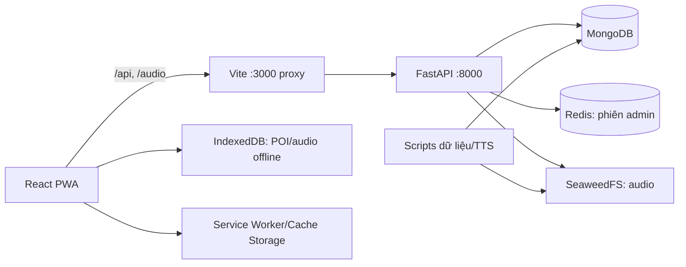

# Tổng quan chức năng và quan hệ file trong dự án

> Tài liệu này lập bản đồ các file dự án đang có trong workspace tại ngày 26/10/2026. Nó mô tả vai trò của file theo nội dung/cấu trúc hiện tại; không thay thế README, hướng dẫn cài đặt, tài liệu kiến trúc hoặc traceability. Các thư mục sinh tự động, thư viện cài đặt và dữ liệu nhị phân được mô tả theo nhóm để tránh liệt kê hàng nghìn file nội bộ không phải mã nguồn dự án.

## 1. Dự án làm gì

Đây là ứng dụng web/PWA hướng dẫn tham quan Thảo Cầm Viên theo nhiều ngôn ngữ. Bản đang bàn giao là demo mô phỏng: frontend React/Vite cung cấp khu tham quan và khu admin; backend FastAPI phục vụ POI, đăng nhập, audio, geofence và sự kiện analytics. MongoDB lưu dữ liệu nghiệp vụ, Redis giữ phiên admin, SeaweedFS lưu MP3 qua API tương thích S3. Trình duyệt dùng IndexedDB và Service Worker để giữ POI/audio/tài nguyên ngoại tuyến.

Luồng tổng quát:

## 2. File cấp gốc

| File | Vai trò | Quan hệ |
|---|---|---|
| `README.md` | Yêu cầu/use case gốc UC-01 đến UC-10 và mô tả mục tiêu sản phẩm. | Đọc cùng `docs/REQUIREMENTS_TRACEABILITY.md` để phân biệt mục tiêu với phần đã làm; không dùng riêng README làm bằng chứng nghiệm thu. |
| `HUONG_DAN_CAI_DAT_VA_BAN_GIAO.md` | Hướng dẫn Windows/PowerShell/Docker: bật hệ thống, khôi phục DB/audio, chạy và dừng demo. | Gọi các script trong `scripts/`, phụ thuộc MongoDB/Redis/SeaweedFS, Python và Node. |
| `IMPLEMENTATION_PLAN.md` | Kế hoạch, quyết định và các giai đoạn triển khai ban đầu. | Là tài liệu kế hoạch/lịch sử; trạng thái thực tế cần đối chiếu `docs/CURRENT_ARCHITECTURE.md` và `docs/ROADMAP_CURRENT_STATE.md`. |
| `README_SEED_DATASET.md` | Hướng dẫn seed dataset demo. | Dùng `scripts/seed_dataset.py`, `scripts/seed_demo_experience.py`, CSV/JSON trong `data/dataset`; chỉ chạy trên DB dev phù hợp. |
| `README_SYNC_FRENCH.md` | Hướng dẫn đồng bộ/hiệu đính dữ liệu tiếng Pháp. | Dùng `scripts/sync_french_dataset.py` và các CSV dataset. |
| `Rules.md` | Quy tắc ngắn cho cộng tác/triển khai trong repo. | Bổ sung quy ước cho người sửa code; không phải tài liệu kiến trúc runtime. |
| `.env.example` | Mẫu biến môi trường backend, MongoDB, Redis, storage S3 và tùy chọn TTS. | Giá trị phải được nạp vào tiến trình theo hướng dẫn; file mẫu không chứa cấu hình runtime thực. |
| `.gitignore` | Loại môi trường ảo, dependencies, build, cache, dữ liệu runtime và file bí mật khỏi Git. | Kiểm soát những gì được đưa vào repository; không ảnh hưởng trực tiếp đến runtime. |
| `TCV-handoff-20261021.zip` | Gói bàn giao nén gồm archive MongoDB, SeaweedFS, image, source.zip, metadata/checksum và hướng dẫn nhận. | Bản đóng gói của thư mục `TCV-handoff-20261021/`; dùng theo hướng dẫn bàn giao, chứa thông tin nhạy cảm nên cần lưu/chuyển riêng tư. |
| `TONG_QUAN_CAU_TRUC_VA_CHUC_NANG.md` | Tài liệu bản đồ file và quan hệ trong workspace. | File tổng hợp này. |

## 3. Backend (`backend/`)

### 3.1. Ứng dụng và cấu hình

| File | Chức năng | Kết nối tới |
|---|---|---|
| `backend/__init__.py` | Đánh dấu `backend` là Python package. | Cho phép import các module `backend.*`. |
| `backend/main.py` | Tạo FastAPI app, mở/đóng MongoDB và Redis theo lifespan, đăng ký exception handlers và routers. | Là điểm vào Uvicorn; nối `api/`, `config.py`, `core/`, `database/`. |
| `backend/config.py` | Đọc và kiểm tra `MONGODB_URI`, `MONGODB_DATABASE`, `REDIS_URL`. | Được `main.py`, database clients và các script sử dụng. |
| `backend/requirements.txt` | Dependencies runtime Python. | Cài để chạy FastAPI, MongoDB async driver, Redis, S3 và các tích hợp. |
| `backend/requirements-dev.txt` | Dependencies phục vụ phát triển/kiểm thử Python. | Bổ sung trên requirements runtime khi làm việc phát triển. |

### 3.2. API routes (`backend/api/`)

| File | Chức năng | Quan hệ |
|---|---|---|
| `backend/api/__init__.py` | Khai báo package API. | — |
| `backend/api/admin.py` | Endpoint quản trị POI, localization/nội dung, audio/package và analytics theo quyền. | Dùng xác thực admin, repository POI/audio, MongoDB, schema và service audio. |
| `backend/api/admin_auth.py` | Đăng nhập/đăng xuất và trạng thái phiên quản trị. | Dùng `services/admin_auth.py`, Redis session, role/permission trong MongoDB. |
| `backend/api/audio.py` | Endpoint audio: truy vấn/resolve nội dung và asset, thao tác package/task theo API. | Kết nối schemas audio, repository audio/POI, dịch vụ lưu trữ và MongoDB. |
| `backend/api/geofences.py` | Trả các vùng geofence đang hoạt động. | Đọc collection geofence và được frontend map dùng để mô phỏng/kiểm tra vị trí. |
| `backend/api/health.py` | Health endpoint để xác nhận backend phản hồi. | Dùng bởi launcher/kiểm tra vận hành; health không tự chứng minh DB/storage đầy đủ. |
| `backend/api/pois.py` | API đọc danh sách POI và catalog loài theo ngôn ngữ. | Dùng `POIRepository`, schema POI và MongoDB; frontend map/home/explore gọi. |
| `backend/api/visitor.py` | Ghi event visitor/analytics, playback history và event vị trí/geofence. | Nhận event từ dịch vụ frontend analytics; ghi collections analytics/playback/location trong MongoDB. |

### 3.3. Core và database

| File | Chức năng | Quan hệ |
|---|---|---|
| `backend/core/exception_handlers.py` | Chuẩn hóa lỗi validation, HTTP và lỗi không dự kiến thành response API nhất quán. | Được đăng ký trong `main.py`; theo hợp đồng `docs/API_CONVENTIONS.md`. |
| `backend/database/__init__.py` | Đánh dấu package database. | — |
| `backend/database/mongodb.py` | Tạo/đóng MongoDB async client và cung cấp database dependency. | Đọc settings từ `config.py`; được API/repository dùng. |
| `backend/database/redis_client.py` | Tạo/đóng Redis async client và cung cấp client dùng chung. | Đọc `REDIS_URL`; xác thực admin sử dụng session/rate-limit. |

### 3.4. Repository, schema và service

| File | Chức năng | Quan hệ |
|---|---|---|
| `backend/repositories/audio.py` | Truy vấn và cập nhật metadata task/asset/package audio trong MongoDB. | Được audio API/service gọi; quan hệ với POI và localization. |
| `backend/repositories/poi_repository.py` | Đọc/ghi POI và bản dịch theo ngôn ngữ, xử lý ObjectId/serialization. | Dùng bởi `api/pois.py` và admin API; dữ liệu từ `poi`, `poi_localizations`. |
| `backend/schemas/audio.py` | Pydantic request/response contracts cho audio, task và package. | Được audio routes và service dùng. |
| `backend/schemas/common.py` | Kiểu dùng chung cho response/pagination/identifier. | Import bởi các schema và API. |
| `backend/schemas/poi.py` | Pydantic contracts cho POI và localization. | Dùng bởi POI/admin API và repository. |
| `backend/services/admin_auth.py` | Quy tắc xác thực password, session cookie, role/permission admin. | Kết hợp `admin_auth.py` route, Redis, collections admin_users/roles. |
| `backend/services/audio.py` | Logic nghiệp vụ audio: tìm asset phù hợp POI/ngôn ngữ, trạng thái task và manifest gói. | Điều phối audio repository, storage và API. |
| `backend/services/audio_storage.py` | Adapter tương thích S3 để đọc/ghi MP3, kiểm tra metadata/checksum theo cấu hình. | Kết nối SeaweedFS; được audio service/API và script seed dùng. |

### 3.5. Khung thư mục/chỗ mở rộng

Các file `.gitkeep` dưới đây chỉ giữ thư mục trống trong Git, không chứa nghiệp vụ runtime:

| File | Mục đích thư mục |
|---|---|
| `backend/api/.gitkeep` | Giữ package API khi trống. |
| `backend/core/.gitkeep` | Giữ vị trí cho xử lý dùng chung. |
| `backend/integrations/storage/.gitkeep` | Chỗ dành cho tích hợp storage. |
| `backend/integrations/translation/.gitkeep` | Chỗ dành cho tích hợp dịch. |
| `backend/integrations/tts/.gitkeep` | Chỗ dành cho tích hợp TTS. |
| `backend/models/.gitkeep` | Chỗ dành cho model domain. |
| `backend/modules/admin/.gitkeep` | Khu vực module admin theo cấu trúc dự kiến. |
| `backend/modules/analytics/.gitkeep` | Khu vực module analytics dự kiến. |
| `backend/modules/audio/.gitkeep` | Khu vực module audio dự kiến. |
| `backend/modules/auth/.gitkeep` | Khu vực module auth dự kiến. |
| `backend/modules/content/.gitkeep` | Khu vực module nội dung dự kiến. |
| `backend/modules/localization/.gitkeep` | Khu vực module localization dự kiến. |
| `backend/modules/location/.gitkeep` | Khu vực module vị trí dự kiến. |
| `backend/modules/maps/.gitkeep` | Khu vực module bản đồ dự kiến. |
| `backend/repositories/.gitkeep` | Giữ thư mục repository. |
| `backend/schemas/.gitkeep` | Giữ thư mục schema. |
| `backend/services/.gitkeep` | Giữ thư mục service. |
| `backend/services/audio/.gitkeep` | Chỗ mở rộng service audio. |
| `backend/services/location/.gitkeep` | Chỗ mở rộng service vị trí. |
| `backend/services/poi/.gitkeep` | Chỗ mở rộng service POI. |
| `backend/services/translation/.gitkeep` | Chỗ mở rộng service dịch. |

## 4. Frontend (`frontend/`)

### 4.1. Điểm vào, điều hướng, layout và view

| File | Chức năng | Quan hệ |
|---|---|---|
| `frontend/package.json` | Khai báo dependencies và lệnh `dev`, `build`, `preview`, `test`. | Nguồn cấu hình npm/Vite. |
| `frontend/package-lock.json` | Khóa cây phiên bản dependency npm. | Được `npm ci` dùng để cài nhất quán. |
| `frontend/index.html` | HTML shell có phần tử mount React và metadata trang. | Vite phục vụ/build; `src/main.jsx` gắn ứng dụng vào đây. |
| `frontend/vite.config.js` | Cấu hình React plugin, port 3000, proxy `/api` và `/audio` sang backend, service worker khi dev/build. | Nối trình duyệt với FastAPI; tạo `sw.js` cho build. |
| `frontend/src/main.jsx` | Bootstrap React, import CSS, đăng ký service worker. | Mount `app/App.jsx`. |
| `frontend/src/app/App.jsx` | Ghép `LanguageProvider`, router và modal chọn ngôn ngữ. | Lớp ứng dụng bao mọi route. |
| `frontend/src/app/router.jsx` | Khai báo URL public (`/`, `/map`, `/explore`, `/itinerary`, `/guide`) và admin (`/admin`, `/admin/analytics`). | Gắn layout và view; tải Admin/Dashboard lazy. |
| `frontend/src/app/index.css` | CSS toàn cục và giao diện visitor. | Được import bởi `main.jsx`. |
| `frontend/src/app/admin.css` | CSS cho khu quản trị/dashboard. | Được import bởi `main.jsx`. |
| `frontend/src/components/layout/PublicLayout.jsx` | Khung điều hướng/header/footer khu khách tham quan. | Chứa các route visitor. |
| `frontend/src/components/layout/AdminLayout.jsx` | Khung điều hướng, trạng thái đăng nhập và nội dung admin. | Bao admin views, gọi API auth. |
| `frontend/src/components/layout/BrandLogo.jsx` | Logo dùng chung trong layout. | Được layout public/admin sử dụng. |
| `frontend/src/components/views/HomeView.jsx` | Trang chính: giới thiệu, thẻ POI/gói và điều hướng các chức năng. | Dùng localization, POI/audio packages và assets. |
| `frontend/src/components/views/MapView.jsx` | Bản đồ POI, trạng thái GPS/geofence và phát audio theo lựa chọn/mô phỏng. | Ghép `InteractiveMap`, `poiLoader`, geolocation, audio, analytics. |
| `frontend/src/components/views/ExploreView.jsx` | Khám phá danh mục POI và luồng quét QR. | Dùng `QrScanner`, dữ liệu POI và localization. |
| `frontend/src/components/views/ItineraryView.jsx` | Giao diện lộ trình/tham quan. | Dùng POI và localization; là màn visitor. |
| `frontend/src/components/views/GuideView.jsx` | Hướng dẫn sử dụng/giới thiệu chế độ demo. | Nội dung UI visitor/localized. |
| `frontend/src/components/views/NotFoundView.jsx` | Trang route không tồn tại. | Được router dùng cho wildcard. |
| `frontend/src/components/views/AdminView.jsx` | Giao diện đăng nhập và quản lý POI/localization/audio/QR. | Gọi admin APIs; dùng localization quản trị và `AdminLayout`. |
| `frontend/src/components/views/AnalyticsDashboard.jsx` | Hiển thị số liệu, biểu đồ và bộ lọc analytics cho admin. | Gọi `services/analytics.js`, yêu cầu quyền analytics. |
| `frontend/src/components/AnimalImageCredit.jsx` | Hiển thị ảnh loài cùng nguồn/credit/license. | Kết hợp metadata ảnh trong dataset với đường dẫn ảnh public. |

### 4.2. Ngôn ngữ (`frontend/src/features/localization/`)

| File | Chức năng | Quan hệ |
|---|---|---|
| `adminMessages.js` | Chuỗi UI cho màn hình quản trị theo ngôn ngữ. | Được language context/hook admin sử dụng. |
| `LanguageContext.jsx` | React context/provider cho ngôn ngữ hiện hành, đổi ngôn ngữ và lưu lựa chọn. | Bọc toàn app; kết nối `languages.js`, storage và modal. |
| `languages.js` | Danh sách mã/ngôn ngữ được hỗ trợ và nhãn hiển thị. | Dùng bởi selector/context, API query và gói offline. |
| `LanguageSelectorModal.jsx` | Modal chọn ngôn ngữ. | Được `App.jsx` render; cập nhật language context. |
| `languageStorage.js` | Đọc/ghi lựa chọn ngôn ngữ trên trình duyệt. | Được `LanguageContext.jsx` gọi. |
| `messages.js` | Từ điển chuỗi tính năng/map/app cho các ngôn ngữ. | Hàm translate dùng bởi hook/component. |
| `siteMessages.js` | Chuỗi nội dung/nhãn phía site theo ngôn ngữ. | Được UI visitor truy xuất. |
| `useTranslation.js` | Hook tiện ích để lấy hàm dịch trong component. | Đọc language context và message catalogs. |

### 4.3. Bản đồ, QR, offline và lưu trữ client

| File | Chức năng | Quan hệ |
|---|---|---|
| `frontend/src/features/map/InteractiveMap.jsx` | Bản đồ MapLibre/OSM, marker POI, chọn điểm và hiển thị trạng thái. | Nhận POI/geolocation từ view và hook. |
| `frontend/src/features/map/geoUtils.js` | Hàm tính khoảng cách/vùng tròn và tiện ích địa lý. | Dùng bởi bản đồ/geofence; được unit test. |
| `frontend/src/features/map/poiLoader.js` | Tải POI theo ngôn ngữ, chuyển sang dữ liệu local khi API lỗi. | Gọi POI repository và IndexedDB cache. |
| `frontend/src/features/map/useGeolocation.js` | Hook đọc vị trí browser, trạng thái quyền/lỗi và cập nhật tọa độ. | Dùng bởi `MapView`/`InteractiveMap`; vị trí phụ thuộc quyền trình duyệt. |
| `frontend/src/features/qr/QrScanner.jsx` | Quét QR camera và giải mã định dạng điều hướng POI/package. | Dùng thư viện ZXing; tích hợp Explore/audio package. |
| `frontend/src/features/offline/audioPackages.js` | Tải manifest và audio assets, kiểm kích thước/checksum, lưu package offline và hỗ trợ rollback khi lỗi/hủy. | Gọi backend audio endpoints; lưu Blob/metadata vào IndexedDB. |
| `frontend/src/db/indexedDB.js` | Tạo schema và thao tác IndexedDB cho POI, localization/audio/package offline. | Dùng bởi cache, offline package, map/audio. |
| `frontend/src/services/poiRepository.js` | Lớp truy xuất POI qua API, chuẩn hóa lỗi và dùng cache cục bộ. | Được view/poiLoader gọi; nối backend POI API với IndexedDB. |
| `frontend/src/services/cacheStorage.js` | Tiện ích Cache Storage cho tài nguyên/nội dung phía trình duyệt. | Bổ trợ offline và Service Worker. |
| `frontend/src/services/networkStatus.js` | Theo dõi trạng thái online/offline của browser. | Được UI/offline flows dùng để phản hồi khi mất mạng. |
| `frontend/src/services/analytics.js` | Gửi visitor events/session/playback/location về backend. | Được Map/Home/audio flows gọi; ghi vào MongoDB qua `api/visitor.py`. |
| `frontend/src/sw/registerServiceWorker.js` | Đăng ký `/sw.js` và xử lý service worker ở browser. | `main.jsx` gọi; `vite.config.js` phục vụ worker dev và phát worker build. |

### 4.4. Assets và file giữ chỗ frontend

| File/nhóm | Vai trò | Quan hệ |
|---|---|---|
| `frontend/public/manifest.json` | Metadata PWA, tên/biểu tượng và cách cài ứng dụng. | Browser đọc cùng icons và service worker. |
| `frontend/public/icons/icon-192.png`, `icon-512.png` | Biểu tượng PWA ở các kích thước. | Được khai báo trong manifest. |
| `frontend/public/images/animals/*.jpg` | Ảnh cục bộ cho 11 POI cộng ảnh hổ ở trang chủ; tên file `tcv-an-001`…`011`, `crested-argus`, `bengal-tiger`. | Được `AnimalImageCredit.jsx`/views sử dụng; mapping và attribution tại `data/dataset/demo_image_credits.json`. |
| `frontend/src/assets/fonts/NotoSans.ttf` | Font Noto Sans đi kèm ứng dụng. | CSS import/khai báo làm font giao diện. |
| `frontend/src/assets/fonts/OFL.txt` | Giấy phép SIL Open Font License cho font. | Đi cùng file font. |
| `frontend/public/.gitkeep`, `frontend/src/app/.gitkeep`, `frontend/src/components/.gitkeep`, `frontend/src/db/.gitkeep`, `frontend/src/features/.gitkeep`, `frontend/src/features/admin/.gitkeep`, `frontend/src/features/analytics/.gitkeep`, `frontend/src/features/audio/.gitkeep`, `frontend/src/features/explorer/.gitkeep`, `frontend/src/features/localization/.gitkeep`, `frontend/src/features/location/.gitkeep`, `frontend/src/features/map/.gitkeep`, `frontend/src/features/offline/.gitkeep`, `frontend/src/features/qr/.gitkeep`, `frontend/src/services/.gitkeep`, `frontend/src/stores/.gitkeep`, `frontend/src/sw/.gitkeep`, `frontend/src/components/.gitkeep` | File rỗng giữ cấu trúc thư mục/điểm mở rộng trong Git; không tạo chức năng runtime. | Các module thật nằm cạnh hoặc dưới những thư mục này. |

### 4.5. Frontend tests

| File | Phạm vi |
|---|---|
| `frontend/tests/geoUtils.test.js` | Kiểm thử hàm hình học/vùng địa lý của bản đồ. |
| `frontend/tests/poiRepository.test.js` | Kiểm thử request POI, chuẩn hóa response, lỗi HTTP/mạng và contract. |

## 5. Dataset (`data/dataset/`)

| File | Nội dung/vai trò | Được dùng bởi |
|---|---|---|
| `content_fact_review.csv` | Bảng rà soát tính đúng đắn của nội dung/nguồn thông tin. | Quy trình kiểm duyệt dữ liệu thủ công. |
| `coordinate_verification_template.csv` | Mẫu đối chiếu/xác minh tọa độ POI. | Công việc xác minh tọa độ trước khi cập nhật seed/database. |
| `demo_image_credits.json` | Mapping mã POI với ảnh, URL nguồn, tác giả, giấy phép, đường dẫn local và kích thước. | Script tải ảnh, attribution component và kiểm tra audit. |
| `language_manifest.csv` | Danh sách/mã ngôn ngữ dùng trong dataset. | Đồng bộ/seed và kiểm tra đủ ngôn ngữ. |
| `poi_candidates.csv` | Danh sách điểm/loài ứng viên cho nội dung. | Đầu vào biên tập/chuẩn bị dataset; không đồng nghĩa toàn bộ đã active trong DB. |
| `poi_demo_coordinates.csv` | Tọa độ mô phỏng cho các POI demo. | Script seed và kiểm thử bản đồ; vị trí không phải xác nhận thực địa. |
| `poi_geo_reference_points.csv` | Điểm tham chiếu địa lý để kiểm chứng hoặc xây dựng tọa độ. | Quy trình kiểm tra map/dataset. |
| `poi_localizations_multilingual_v2.csv` | Bản dịch/nội dung POI đa ngôn ngữ phiên bản dataset hiện hành. | `seed_dataset.py`, `sync_french_dataset.py`; chuyển vào MongoDB `poi_localizations`. |
| `source_register.csv` | Sổ đăng ký nguồn và tham chiếu nội dung/ảnh. | Biên tập, attribution và kiểm tra nguồn. |
| `translation_review_checklist.csv` | Checklist soát chất lượng bản dịch. | Quy trình duyệt localization. |

## 6. Scripts vận hành và dữ liệu (`scripts/`)

| File | Chức năng | Quan hệ/ảnh hưởng |
|---|---|---|
| `scripts/start_demo.ps1` | Kiểm tra dịch vụ/cấu hình, chuẩn bị biến môi trường, chạy backend/frontend preview và tùy chọn tunnel; ghi log/URL demo. | Gọi Python, npm/Vite, Docker; URL/QR/log/PID ở `.demo-run/`. |
| `scripts/stop_demo.ps1` | Dừng tiến trình demo do launcher nhận diện. | Dùng PID/log metadata `.demo-run`; không dừng Mongo/Redis/SeaweedFS. |
| `scripts/check_storage_access.ps1` | Đọc biến S3 từ container SeaweedFS, gọi Python checker. | Wrapper cho `check_storage_access.py`; cần `.venv`. |
| `scripts/check_storage_access.py` | Kiểm tra S3 endpoint truy cập được và bucket cấu hình tồn tại; không in credentials. | Dùng boto3 và biến môi trường; endpoint SeaweedFS. |
| `scripts/check_admin_state.ps1` | Wrapper PowerShell để kiểm tra trạng thái admin/session theo môi trường. | Gọi `check_admin_state.py`, cần Docker/Python phù hợp. |
| `scripts/check_admin_state.py` | Kiểm tra trạng thái tài khoản/quyền admin trong MongoDB, phục vụ chẩn đoán. | Dùng config/MongoDB của hệ thống. |
| `scripts/create_admin.py` | Tạo admin người dùng mới có password hash và role/permissions. | Ghi collection `admin_users`/`roles`; đọc Mongo URI/database từ environment. |
| `scripts/seed_dataset.py` | Nạp hoặc cập nhật POI/localization và metadata demo từ CSV. | Dùng các file trong `data/dataset`; ghi MongoDB. |
| `scripts/seed_demo_experience.py` | Chuẩn bị trải nghiệm demo đầy đủ: ảnh, TTS/audio tasks/assets/packages và dữ liệu minh họa. | Kết nối dataset, TTS/provider, SeaweedFS và MongoDB; thay đổi dữ liệu nên chỉ chạy trên DB demo. |
| `scripts/download_demo_images.py` | Tải ảnh được khai báo trong credit manifest về frontend public images. | Dùng `demo_image_credits.json`, sinh file jpg. |
| `scripts/sync_french_dataset.py` | Đồng bộ/kiểm tra nội dung Pháp theo dataset và tránh làm mất các trường/ID liên quan. | Dùng CSV và MongoDB; hướng dẫn tại README_SYNC_FRENCH. |
| `scripts/audit_runtime.py` | Audit runtime dạng chỉ đọc: số bản ghi, liên kết, ảnh/audio/checksum/manifest. | Kết nối MongoDB, SeaweedFS và file assets. |
| `scripts/prepare_handoff_backup.py` | Chuẩn bị/kiểm tra đầu vào và metadata cho quy trình đóng gói backup bàn giao. | Hỗ trợ quy trình ở mục 6 của hướng dẫn; tương tác với archive/container. |
| `scripts/verify_handoff_backup.py` | Xác minh file backup/gói bàn giao và checksum/metadata. | Dùng manifest/checksum trong gói handoff. |
| `scripts/write_demo_qr.mjs` | Sinh QR image cho URL demo/tunnel. | Được launcher hoặc hướng dẫn gọi; dùng package QR npm. |
| `scripts/write_demo_poi_qr_sheet.mjs` | Tạo trang in QR cho các mã POI demo. | Được luồng demo QR dùng; đầu ra lưu dưới `.demo-run/`. |
| `scripts/.gitkeep` | Giữ thư mục scripts trong Git. | Không có runtime behavior. |

## 7. Tài liệu (`docs/`)

| File | Vai trò | Quan hệ/đối tượng đọc |
|---|---|---|
| `docs/API_CONVENTIONS.md` | Hợp đồng response/error API, validation và mẫu POI. | Backend exception handlers, schemas và frontend API clients. |
| `docs/AUDIT_REPORT_2026-10-21.md` | Kết quả audit/test, lỗi đã sửa, phạm vi và giới hạn xác minh. | Bằng chứng của một đợt kiểm chứng cụ thể; đọc cùng architecture/traceability. |
| `docs/CLEANUP_REVIEW.md` | Nhật ký file được lưu trữ, lý do giữ/xóa và trạng thái dọn repo. | Liên kết đến khu archive; giúp tránh dùng tài liệu/file cũ như runtime hiện tại. |
| `docs/CURRENT_ARCHITECTURE.md` | Mô tả as-built component, deployment, data relations và giới hạn. | Tài liệu chuẩn để hiểu kết nối backend/frontend/Mongo/Redis/Seaweed. |
| `docs/DATABASE_TASK_SCENARIOS.md` | Kịch bản/đầu việc thiết kế và xử lý dữ liệu database. | Hỗ trợ phát triển và thảo luận nghiệp vụ/schema. |
| `docs/DEMO_DATASET.md` | Mô tả dataset demo, lệnh seed và sinh nội dung demo. | Dùng với scripts và CSV; nhấn mạnh demo/simulated content. |
| `docs/DEVELOPMENT.md` | Quy trình dev, lệnh cài/chạy/kiểm tra và môi trường. | Dành cho lập trình viên; bổ sung hướng dẫn bàn giao. |
| `docs/PUSH_AND_HANDOFF.md` | Quy trình chuẩn bị source/commit/push/bàn giao repository. | Hỗ trợ quản lý thay đổi và chuyển giao; không thay thế backup DB/audio. |
| `docs/REQUIREMENTS_TRACEABILITY.md` | Ánh xạ yêu cầu/use case tới implementation và gap. | Đối chiếu README mục tiêu với trạng thái as-built. |
| `docs/ROADMAP_CURRENT_STATE.md` | Tóm tắt phần đã có và phần còn lại trong roadmap hiện hành. | Đọc cùng current architecture và audit. |
| `docs/architecture/.gitkeep`, `docs/decisions/.gitkeep`, `docs/PRD/.gitkeep` | Giữ các thư mục kiến trúc, quyết định và PRD. | Không chứa nội dung runtime. |

### 7.1. Kho lưu trữ lịch sử (`docs/archive/pre-audit-2026-10-21/`)

Những file trong đây là tư liệu lịch sử được chuyển khỏi luồng hiện hành; không dùng chúng để suy luận deployment/runtime mới.

| File | Vai trò/trạng thái |
|---|---|
| `README.md` | Giải thích nội dung archive và vì sao các file được lưu. |
| `docker-compose.legacy.yml.txt` | Compose cũ; không dùng để chạy phiên bản bàn giao hiện tại. |
| `bootstrap_demo_admin.py.txt` | Script bootstrap admin cũ, đã lưu để tham khảo. |
| `prepare_mvp_dataset.py.txt` | Script chuẩn bị dataset cũ. |
| `Component_Diagram.png` | Sơ đồ component lịch sử, không phản ánh runtime mới nhất. |
| `Deployment_Diagram.png` | Sơ đồ triển khai cũ, không thay thế current architecture. |
| `Logical_ERD.png` | ERD lịch sử có sai khác đã nêu trong tài liệu kiến trúc. |
| `great-argus-wrong-for-TCV-AN-006.jpg` | Ảnh cũ sai loài, lưu để truy nguyên; ảnh hiện dùng là `crested-argus.jpg`. |

## 8. Kiểm thử (`tests/`)

| File | Phạm vi kiểm thử |
|---|---|
| `tests/test_api_error_handlers.py` | Response lỗi chuẩn hóa của API. |
| `tests/test_api_error_schemas.py` | Contract/schema của response lỗi. |
| `tests/test_audio_api.py` | API audio, asset/package/task và quyền/response liên quan. |
| `tests/test_audio_storage.py` | Adapter lưu trữ S3/SeaweedFS và xử lý audio. |
| `tests/test_audit_regressions.py` | Hồi quy các lỗi đã phát hiện trong audit. |
| `tests/test_backend_connections.py` | Cấu hình và vòng đời kết nối MongoDB/Redis. |
| `tests/test_poi_api.py` | API POI/localization và hợp đồng response. |
| `tests/test_seed_dataset.py` | Seed dataset, tính lặp lại và bảo toàn quan hệ/metadata. |
| `tests/test_sync_french_dataset.py` | Đồng bộ dữ liệu tiếng Pháp. |
| `tests/e2e_audit.py` | Kịch bản audit end-to-end qua browser/API; có fixture tạo và dọn dữ liệu thử. |
| `tests/verify_t06_foundation.mjs` | Kiểm tra nền tảng T06 liên quan service worker/IndexedDB/cache trong build. |
| `tests/.gitkeep` | Giữ thư mục tests. |

Các kiểm thử frontend thuần nằm riêng trong `frontend/tests/`; scripts kiểm tra runtime và dữ liệu nằm trong `scripts/`. Báo cáo về lần chạy đã thực hiện ở `docs/AUDIT_REPORT_2026-10-21.md`; danh sách test không có nghĩa lần chạy mới đã được thực hiện trong lần tạo tài liệu này.

## 9. Gói bàn giao đã giải nén (`TCV-handoff-20261021/`)

| File | Vai trò |
|---|---|
| `README_NHAN_BAN_GIAO.md` | Hướng dẫn nhận và khôi phục gói. |
| `database.archive.gz` | MongoDB dump dạng archive gzip; phục hồi bằng `mongorestore`. |
| `seaweed-data.tar.gz` | Nội dung volume SeaweedFS chứa audio. |
| `seaweed-image.tar` | Docker image SeaweedFS đã lưu để giữ phiên bản tương thích. |
| `seaweed.env` | Biến S3 (access key/secret/bucket); file bí mật, không công khai. |
| `backup-metadata.json` | Metadata về thời điểm/phiên bản và thành phần backup. |
| `RESTORE_VERIFICATION.json` | Kết quả/chi tiết xác minh khôi phục được đóng gói. |
| `SHA256SUMS.txt` | Hash SHA-256 để kiểm tra tính toàn vẹn các thành phần. |
| `source.zip` | Snapshot source chính xác của gói bàn giao. |
| `SOURCE_STATE.txt` | Thông tin nhánh/base commit/tree và trạng thái commit/push của snapshot. |
| `TIN_NHAN_GUI_BAN.txt` | Thông điệp/ghi chú gửi người nhận bàn giao. |

Các archive `.gz`/`.tar`, image `.tar`, zip, hình ảnh, font và icons là dữ liệu nhị phân: chức năng được xác định theo tên, metadata và cách các script dùng, không thể đọc như văn bản nguồn.

## 10. Thư mục cục bộ, build và dependency

Các thư mục sau tồn tại trong workspace nhưng nội dung của chúng là môi trường cài đặt hoặc kết quả sinh ra, không phải phần source cần mô tả từng file nội bộ:

| Thư mục | Ý nghĩa | Tạo/được dùng bởi |
|---|---|---|
| `.venv/` | Python virtual environment và packages cài theo requirements. | Tạo bằng `python -m venv`; script vận hành gọi `.venv/Scripts/python.exe`. |
| `frontend/node_modules/` | Packages npm đã cài. | Tạo bằng npm từ `package-lock.json`. |
| `frontend/dist/` | Bundle build frontend và worker. | Sinh bởi `npm run build`; Vite preview phục vụ thư mục này. |
| `.demo-run/` | Log, PID, URL/QR và kết quả audit demo. | Sinh bởi launcher/script; dữ liệu runtime cục bộ. |
| `.pytest_cache/` | Cache của pytest. | Sinh tự động trong lần chạy Python tests. |
| `.git/` | Metadata, object database và lịch sử Git. | Quản lý version control; không phải chức năng của ứng dụng. |
| `__pycache__/` (nếu có) | Bytecode Python. | Sinh tự động bởi Python interpreter. |

## 11. Mối quan hệ chính giữa các nhóm file

1. **Khởi động web:** `scripts/start_demo.ps1` → FastAPI `backend/main.py` và Vite preview → `frontend/index.html` → `src/main.jsx` → `App.jsx`/`router.jsx` → layout/view.
2. **Đọc POI:** Home/Map/Explore → `services/poiRepository.js`/`features/map/poiLoader.js` → `/api` proxy trong `vite.config.js` → `backend/api/pois.py` → `POIRepository` → MongoDB.
3. **Audio và ngoại tuyến:** view/`audioPackages.js` → backend audio API/service/repository → SeaweedFS; trình duyệt lưu metadata/Blob qua `indexedDB.js`, dùng Service Worker/Cache Storage để giữ shell/assets.
4. **Đăng nhập admin:** `AdminLayout`/`AdminView` → admin auth API → `services/admin_auth.py` → MongoDB `admin_users`/`roles` và Redis session; quyền được kiểm tra trước thao tác admin.
5. **Dashboard:** `AnalyticsDashboard.jsx` → `services/analytics.js` (đọc dashboard data/ghi visitor events theo luồng) → admin/visitor API → MongoDB collections analytics.
6. **Dữ liệu demo:** `data/dataset/*` → seed/sync scripts → MongoDB; `demo_image_credits.json` → downloader → `frontend/public/images`; sinh MP3/package cần SeaweedFS và metadata MongoDB.
7. **Bàn giao:** handoff archive giữ DB + audio + image/config storage; source snapshot giữ code; hai phần cần tương thích phiên bản, không thay thế nhau.
8. **Tài liệu và kiểm chứng:** README mô tả use case; implementation plan ghi kế hoạch; current architecture mô tả hệ đang có; traceability nêu khoảng cách; audit report ghi kết quả của ca audit cụ thể; setup guide hướng dẫn chạy.

## 12. Giới hạn cần hiểu đúng

- Đây là một frontend và một backend dạng modular monolith; thư mục `modules/` có `.gitkeep` không đồng nghĩa đã có microservices.
- Nội dung, tọa độ và giọng TTS demo là mô phỏng. Trang bản đồ nền OSM cần Internet; cache POI/audio không biến bản đồ nền thành offline đầy đủ.
- TTS được chuẩn bị bằng script; backend không tự sinh lời đọc theo thời gian thực khi audio thiếu. Dịch runtime cũng chưa có adapter tự động.
- Gói audio ngoại tuyến là snapshot; sửa localization không tự cập nhật file đã tải.
- Một số yêu cầu trong README/implementation plan chưa được triển khai đầy đủ. Dùng `docs/REQUIREMENTS_TRACEABILITY.md` và `docs/ROADMAP_CURRENT_STATE.md` làm căn cứ gap.
- Danh sách file này phản ánh workspace hiện tại. File trong các thư mục bị loại trừ như `node_modules`, `.venv`, `.git` không được liệt kê từng dependency/object vì chúng là nội dung tạo bởi công cụ, có thể tái tạo và rất lớn.
