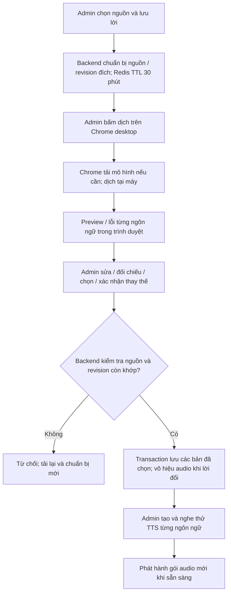

# Dịch nội dung POI bằng Chrome — UC-09

Cập nhật 09/11/2026. Thay phương án Google Cloud Translation trước đó trên nhánh `feature/admin-auto-translation`, chưa merge main. Không cần tài khoản Cloud, billing hay API key; không thêm container dịch. TTS và kho audio giữ luồng hiện có.

## 1. Điều kiện sử dụng

- Admin dùng **Chrome cập nhật trên máy tính**. Translator API có từ Chrome 138, nhưng phải kiểm tra API và từng cặp ngôn ngữ trên profile/máy thực tế; phiên bản mới không bảo đảm mô hình đã sẵn sàng. Xem [tài liệu chính thức Chrome](https://developer.chrome.com/docs/ai/translator-api).
- Mở `http://localhost:3000` trên máy chạy app hoặc URL **HTTPS**. HTTP qua IP LAN không phải secure context thông thường. Điện thoại, trình duyệt không có API hoặc chính sách doanh nghiệp chặn tính năng: nhập bản dịch thủ công trong **Sửa nội dung**.
- Cần Internet để tải mô hình ngôn ngữ lần đầu và đủ dung lượng ổ đĩa. Chrome quản lý các mô hình này trong profile; backup MongoDB/SeaweedFS, Git và gói audio offline không mang chúng sang máy khác.
- Backend, MongoDB replica set `rs0`, Redis vẫn phải chạy và truy cập được để chuẩn bị/xác nhận lưu. Việc mô hình có thể xử lý tại máy sau khi tải **không** biến toàn bộ admin thành ứng dụng biên tập ngoại tuyến.
- 6 ngôn ngữ hệ thống: Việt, Anh, Pháp, Trung giản thể, Nhật, Hàn. Chọn một nguồn, tối đa 5 đích. Cặp nào Chrome báo không sẵn sàng thì giao diện giải thích và giữ đường nhập thủ công. Mã `zh-Hans` chỉ đổi thành `zh` khi gọi native API; database vẫn dùng `zh-Hans`.

## 2. Cách chạy và dùng thử

1. Bật MongoDB, Redis và SeaweedFS trong Docker Desktop.
2. Tại thư mục dự án, chạy như luồng cũ:

   ```powershell
   .\.venv\Scripts\python.exe -m pip install -r backend/requirements.txt
   powershell -NoProfile -ExecutionPolicy Bypass -File .\scripts\start_demo.ps1 -NoTunnel
   ```

   Mở Chrome máy tính tại `http://localhost:3000/admin`. Nếu backend/frontend bản cũ còn chạy, dùng `scripts/stop_demo.ps1` rồi mở lại launcher. Để dùng HTTPS tunnel cho điện thoại, chạy launcher không có `-NoTunnel`; URL mới có thể đổi vùng cache offline.
3. Đăng nhập tài khoản có `poi:write`, `content:write`, `audio:write`. Chọn ngôn ngữ nội dung trong quản trị.
4. Thêm POI và **Lưu** trước, hoặc mở **Sửa nội dung** của POI đã có, nhập tiêu đề/lời bằng ngôn ngữ nguồn rồi **Lưu nháp**. Nên giữ POI ẩn khi chuẩn bị. Mô tả hệ thống trong **Sửa POI** không phải lời thuyết minh nguồn tự dịch.
5. Trong khung **Dịch tự động**, bấm **Chuẩn bị bản xem trước**. Backend kiểm tra nguồn, lấy nội dung/revision đích để đối chiếu và giữ token 30 phút; bước này chưa tải mô hình hoặc dịch.
6. Bấm **Dịch các ngôn ngữ đang chờ** hoặc nút **Dịch / tải gói ngôn ngữ** của từng đích. Đây là thao tác người dùng để Chrome cho phép tải mô hình. Giao diện hiện tiến độ tải, xử lý, lỗi và nút hủy; thao tác có timeout 5 phút. Mô hình không tự tải khi chỉ mở form. Nếu batch gặp lỗi quyền thao tác, bấm nút riêng từng ngôn ngữ.
7. Đọc và sửa các bản thành công. Nếu đích đã có nội dung, mở phần đối chiếu và đánh dấu đồng ý thay thế; bản cũ mặc định được giữ. Chọn từng bản muốn lưu. Khi sửa lại văn bản, ô chọn lưu được bỏ để bạn xác nhận lại.
8. Bấm **Xác nhận lưu các bản đã chọn**. Chỉ lúc này văn bản mới được ghi MongoDB. Có thể lưu các bản thành công trước rồi dịch lại bản lỗi bằng cùng preview. Không cần dịch/lưu đủ 5 ngôn ngữ một lần.
9. Chọn từng ngôn ngữ đã lưu trong quản trị → **Sửa nội dung** → chọn giọng → **Lưu và tạo audio** → chờ Completed → nghe thử. Dịch văn bản không tự sinh audio đồng loạt.
10. Khi sẵn sàng, bật POI và phát hành gói audio mới cho khách tải. Gói/audio đã tải trước đó là snapshot, không tự đổi theo nội dung mới.

**Lưu nháp không phải chờ xuất bản:** nội dung đã lưu của POI active có thể được khách đọc ngay. Bản dịch xem trước chưa xác nhận mới được giữ ngoài dữ liệu công khai.

## 3. Khi không dịch được

| Tình huống | Cách xử lý |
|---|---|
| Báo trình duyệt không hỗ trợ | Dùng Chrome mới trên máy tính qua localhost/HTTPS; kiểm tra chính sách trình duyệt. Nhập thủ công nếu không có native API. |
| Một cặp ngôn ngữ không sẵn sàng | Không suy ra rằng mọi cặp đều hoạt động từ danh sách 6 ngôn ngữ; dùng nhập thủ công cho đích đó. |
| Yêu cầu thao tác người dùng | Bấm nút dịch riêng của ngôn ngữ; không gọi tải mô hình từ background hoặc sau chuỗi fetch. |
| Tải đứng/lỗi/timeout | Kiểm tra Internet, dung lượng ổ đĩa, chính sách tải mô hình; hủy và thử lại từng ngôn ngữ. Không bật cờ thử nghiệm hoặc tắt bảo mật để ép chạy. |
| Văn bản vượt giới hạn | Rút ngắn nguồn rồi lưu/chuẩn bị lại, hoặc nhập thủ công. App chia mô tả dài thành đoạn nhỏ nhưng không bảo đảm mọi quota native. Không tự cắt mất lời dịch để lưu. |
| Preview hết 30 phút | Chuẩn bị lại. Nút chuẩn bị lại thay các bản xem trước đang chỉnh; lưu hoặc sao chép lời cần giữ trước. Retry dịch không kéo dài TTL. |
| Xung đột 409 | Nguồn hoặc bản đích đã đổi, kể cả tác vụ audio cập nhật. Tải lại danh sách và chuẩn bị mới; không ép ghi đè bằng preview cũ. |
| Mất mạng lúc xác nhận lưu | Kết quả có thể đã commit. Kiểm tra danh sách trước khi làm lại. Hủy/đóng màn hình không rollback request lưu đã gửi. |

## 4. Luồng dữ liệu và tính nhất quán

1. Frontend kiểm tra secure context, native `Translator` và `availability()` cho từng cặp. Kiểm tra khả năng không tự tải mô hình.
2. `POST .../translations/preview` giữ **nguồn và revision bản đích**, gắn admin/POI, trong Redis 30 phút. Giới hạn chuẩn bị một lần/admin/3 giây; backend không dịch hoặc gọi dịch vụ tính phí.
3. `Translator.create()` chạy trực tiếp từ nút bấm, báo tiến độ tải; native `translate()` xử lý tiêu đề/lời tại máy. App chia lời dài thành đoạn tối đa khoảng 1000 code point, giữ dòng trống. Bản dịch mới và chỉnh sửa chỉ ở bộ nhớ trình duyệt trước commit. Đóng form/tải lại sẽ mất phần chưa lưu.
4. `POST .../translations/commit` kiểm tra cookie/quyền, token, nguồn đã lưu còn khớp, revision đích và xác nhận thay thế. Các bản được chọn trong **một request** được lưu trong một transaction; có thể gửi request sau để lưu các đích chưa lưu.
5. Commit bảo đảm unique index `(poi_id,language_code)` của `poi_localizations`; nếu chưa có sẽ tạo `uq_poi_localizations_poi_language`. Nếu dữ liệu trùng hoặc không có quyền tạo index thì từ chối, không tự xóa bản ghi. Cần MongoDB replica set hiện tại.
6. Lời/tiêu đề đích đổi sẽ xóa liên kết audio/task hiện tại của ngôn ngữ đó; kết quả TTS từ lời cũ không được gắn vào lời mới. Không xóa MP3/snapshot cũ. Sửa nguồn đánh dấu bản dịch phụ thuộc `needs_review`, không tự đổi lời/audio đích. Mở bản đích kiểm tra rồi lưu để xác nhận hoặc dịch lại.

Không đổi ObjectId hoặc quan hệ ERD, không thêm collection. `poi_localizations.translation` có metadata tùy chọn:

| Trường | Ý nghĩa |
|---|---|
| `source_language` | Ngôn ngữ nguồn |
| `source_hash` | SHA-256 của tiêu đề/lời nguồn |
| `provider` | `chrome-translator` |
| `origin` | `browser_assisted_admin_reviewed` |
| `translated_at` | Thời điểm admin xác nhận lưu |
| `review_status` | `reviewed_by_admin`, `edited_by_admin`, `needs_review` |

`translation_guard` là metadata nội bộ để bắt xung đột sửa nguồn trong transaction. Backend kiểm tra văn bản do admin gửi, **không chứng minh được Chrome thực sự sinh ra văn bản đó**; provider/origin mô tả luồng hỗ trợ biên tập, không phải chứng nhận độ chính xác hoặc bản dịch nguyên văn. Dữ liệu nhập thủ công cũ không bắt buộc có metadata.

Không gọi Cloud Translation và không cần `GOOGLE_TRANSLATE_API_KEY`; biến cũ nếu đã có không còn được sử dụng. Token preview thuộc phương án Cloud trước đó bị từ chối để yêu cầu chuẩn bị mới. Quyền, session, TTS, ảnh và các gói offline vẫn dùng hạ tầng hiện có.



## 5. Nghiệm thu trên máy admin

Ngày 09/11/2026, người dùng xác nhận nghiệm thu luồng Chrome hoạt động ổn. Đây là xác nhận sử dụng trên môi trường đã thử, không suy rộng thành chứng nhận mọi browser/cặp ngôn ngữ. Sơ đồ và đặc tả hiện hành đã được đồng bộ tại [bộ UC/DFD](Use-case/README.md).

Trong lần chuyển sang Chrome: frontend production build và backend import thành công; launcher đã mở app ở `http://localhost:3000` với MongoDB/Redis/SeaweedFS đang chạy. Kiểm tra chỉ đọc cho thấy MongoDB là `rs0`, không có nhóm trùng `(poi_id,language_code)` trong 69 localization và collection này không có validator chặn metadata mới. Chrome cài trên máy là `156.0.8078.80`. Không sửa nội dung POI hoặc tạo audio để đạt các thông tin này.

Kiểm tra build/import và việc Docker đang chạy không chứng nhận mô hình native đã tải hoặc mọi cặp ngôn ngữ đã hoạt động trên profile Chrome của bạn. Cần thực hiện các bước ở mục 2 trên Chrome thực tế, nghe thử audio và kiểm tra các bản đã lưu. Các báo cáo kiểm thử trước ngày bổ sung này không bao phủ luồng Chrome. Ảnh/export diagram cũ là ảnh chụp phiên bản trước; dùng luồng ở đây và sơ đồ trong `CURRENT_ARCHITECTURE.md` cho báo cáo mới.
