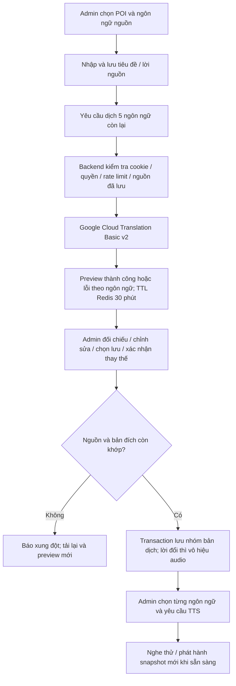

# Dịch tự động nội dung POI — UC-09

Cập nhật 09/11/2026. Đây là chức năng hỗ trợ biên tập cho bản mô phỏng của đồ án. Dịch máy không xác minh thông tin động vật; admin chịu trách nhiệm đọc và xác nhận nội dung.

## 1. Luồng thao tác

Hệ thống có **6 ngôn ngữ tổng cộng**: Việt, Anh, Pháp, Trung giản thể, Nhật, Hàn. Chọn bất kỳ ngôn ngữ nào làm nguồn để dịch sang 5 ngôn ngữ còn lại.

1. Trong quản trị, chọn ngôn ngữ nội dung. Khi thêm POI, nhập tên hệ thống, tiêu đề và lời thuyết minh bằng ngôn ngữ này. **Lưu** POI trước; nên giữ POI ẩn khi chuẩn bị.
2. Với POI đã tồn tại, mở **Sửa nội dung** ở đúng ngôn ngữ nguồn, nhập tiêu đề/lời và **Lưu nháp**. Mô tả hệ thống trong **Sửa POI** là thông tin chung, không phải lời nguồn để tự dịch.
3. Bấm **Dịch sang 5 ngôn ngữ còn lại**. Chỉ tiêu đề và lời thuyết minh được gửi tới Google Cloud Translation; không gửi ảnh, GPS, tài khoản hay mật khẩu.
4. Đọc từng bản xem trước, sửa trực tiếp. Nếu ngôn ngữ đích đã có nội dung, mở phần đối chiếu và đánh dấu đồng ý thay thế. Bản cũ mặc định được giữ; không bản nào tự được chọn lưu.
5. Chọn các bản muốn lưu, bấm **Xác nhận lưu các bản đã chọn**. Bản xem trước chỉ nằm trong trình duyệt/Redis cho đến bước này; chưa sửa MongoDB hoặc tạo audio.
6. Chọn từng ngôn ngữ đã lưu trong quản trị, mở **Sửa nội dung**, chọn giọng rồi **Lưu và tạo audio**. Chờ Completed, nghe thử. Không có thao tác tự tạo đồng loạt audio khi bấm dịch.
7. Bật POI khi sẵn sàng. Phát hành gói audio mới để khách tải bản thu mới; gói/bản tải ngoại tuyến cũ vẫn giữ nguyên snapshot audio.

**Lưu nháp không phải cơ chế chờ xuất bản**: POI đang hiển thị có bản ngôn ngữ vừa lưu thì khách có thể đọc ngay. Chỉ bản xem trước chưa xác nhận mới được giữ ngoài dữ liệu công khai.

## 2. Cấu hình Google Cloud Translation

Adapter dùng **Cloud Translation Basic v2**, không phải dịch vụ dịch web miễn phí và không dùng tài khoản ChatGPT. Basic hỗ trợ API key; xem [xác thực chính thức](https://docs.cloud.google.com/translate/docs/authentication) và [REST translate v2](https://docs.cloud.google.com/translate/docs/reference/rest/v2/translate).

1. Vào Google Cloud Console, tạo/chọn project và thiết lập billing theo [hướng dẫn Google](https://docs.cloud.google.com/translate/docs/setup).
2. Bật **Cloud Translation API** cho project.
3. Tạo API key tại **APIs & Services → Credentials**. Giới hạn API của key vào Cloud Translation API. Key được dùng ở backend; không đặt HTTP referrer restriction dành cho trình duyệt. Có thể giới hạn IP nếu máy triển khai có IP đi ra cố định.
4. Cấu hình quota/ngân sách trong Google Cloud. Một lần dịch đầy đủ gọi 5 request, mỗi request gồm tiêu đề và mô tả nguồn; thử lại cũng có thể phát sinh chi phí. Kiểm tra [biểu phí hiện hành](https://cloud.google.com/translate/pricing) trong tài khoản của bạn.
5. Cài dependency tại thư mục dự án:

   ```powershell
   .\.venv\Scripts\python.exe -m pip install -r backend/requirements.txt
   ```

6. Trong PowerShell **sẽ dùng để chạy backend/launcher**, nhập key qua lời nhắc để không ghi key thật vào lịch sử câu lệnh:

   ```powershell
   $translationSecret = Read-Host 'Google Cloud Translation API key' -AsSecureString
   $translationCredential = [System.Net.NetworkCredential]::new('', $translationSecret)
   $env:GOOGLE_TRANSLATE_API_KEY = $translationCredential.Password
   Remove-Variable translationCredential, translationSecret
   powershell -NoProfile -ExecutionPolicy Bypass -File .\scripts\start_demo.ps1
   ```

   Launcher truyền môi trường của PowerShell sang backend mới. Nếu backend cũ còn chạy, key mới **không** tự được áp dụng: tắt dịch vụ bằng `scripts/stop_demo.ps1` rồi chạy lại launcher từ cửa sổ đã đặt key. Khởi động lại tunnel có thể đổi URL và vùng cache offline. Nếu chỉ chạy local, thêm `-NoTunnel` và dùng cookie theo cấu hình local trong hướng dẫn bàn giao.

7. Mở lại quản trị. Nếu chưa có key, khung dịch báo chưa cấu hình và khóa nút dịch; nhập bản dịch thủ công vẫn hoạt động. Có key không đồng nghĩa key hợp lệ: lỗi quyền/quota/mạng được báo theo từng ngôn ngữ khi gọi thật.

Backend **không tự đọc `.env`**; `.env.example` chỉ là mẫu. Không đặt key trong mã nguồn, biến `VITE_*`, file gửi qua Git hay ảnh chụp màn hình. Đóng PowerShell sẽ mất biến môi trường ở cửa sổ đó; lần mở mới cần đặt lại. Máy admin khác cần cấu hình key riêng trong môi trường backend của máy đó.

## 3. Lỗi, xung đột và thời hạn

- Một preview tồn tại **30 phút**, gắn với tài khoản admin và POI. Đóng form/tải lại trang làm mất chỉnh sửa xem trước ở giao diện; Redis không cung cấp màn hình khôi phục draft.
- Có thể lưu các ngôn ngữ dịch thành công, rồi bấm thử lại các ngôn ngữ lỗi. Giới hạn một batch dịch/admin/30 giây; không tự retry request tính phí.
- Mỗi lần thử lại tạo preview riêng. Giao diện lưu lần lượt theo nhóm preview; mỗi nhóm là một transaction, các nhóm trước đã thành công vẫn được giữ nếu nhóm sau lỗi. Nhãn **Đã lưu** cho biết nhóm nào đã hoàn thành.
- Nội dung nguồn phải đã lưu và khớp ở lúc preview **và** lúc xác nhận. Thay đổi nguồn thì phải lưu nguồn và yêu cầu preview mới.
- Nếu bản đích bị admin khác sửa hoặc tác vụ audio cập nhật sau preview, server từ chối ghi đè bằng 409. Tải lại danh sách và dịch lại. Khi lỗi mạng lúc lưu, kết quả commit có thể đã thành công; kiểm tra danh sách trước khi làm lại.
- Trước commit, API bảo đảm index unique `(poi_id, language_code)` của `poi_localizations`; nếu chưa có, tạo `uq_poi_localizations_poi_language`. Không xóa/sửa bản ghi để tạo index. Nếu dữ liệu đã trùng hoặc tài khoản DB không có quyền tạo index, commit bị từ chối và cần người vận hành xử lý nguyên nhân.
- Commit cần MongoDB replica set `rs0` hiện có; không dùng MongoDB standalone thay thế. Các ngôn ngữ trong cùng nhóm được lưu toàn bộ hoặc không lưu nhóm đó. Dữ liệu nguồn được giữ bằng write conflict guard trong transaction.
- Lưu title/description mới làm audio hiện tại của đúng ngôn ngữ mất hiệu lực. Audio đang tạo từ lời cũ không được gắn vào lời mới. File MP3 và snapshot cũ không bị xóa.
- Khi sửa nguồn, các bản được tạo từ nguồn đó được đánh dấu `needs_review`. Chỉ là nhắc rà soát, không tự xóa lời/audio đích chưa thay đổi. Mở bản đích đọc lại rồi lưu để xác nhận hoặc dịch lại. Nguồn sửa về sau có thể tiếp tục yêu cầu rà soát.

## 4. Dữ liệu và ranh giới kiến trúc

Không thêm collection, không đổi ObjectId hoặc quan hệ ERD. Bản lưu dịch bổ sung metadata tùy chọn trong `poi_localizations.translation`:

| Trường | Ý nghĩa |
|---|---|
| `source_language` | Mã ngôn ngữ nguồn |
| `source_hash` | SHA-256 của tiêu đề/lời nguồn |
| `provider` | `google-cloud-basic-v2` |
| `translated_at` | Thời điểm admin xác nhận lưu từ preview |
| `review_status` | `reviewed_by_admin`, `edited_by_admin`, `needs_review` |

`translation_guard` là giá trị nội bộ phục vụ chống ghi đồng thời ở bản nguồn; không phải khóa hay quan hệ mới. Nội dung đích có thể đã được admin chỉnh sau dịch máy; metadata không chứng nhận độ chính xác hoặc dịch nguyên văn. Bản nhập thủ công cũ không bị bắt buộc thêm metadata.

Redis chứa draft với TTL và rate limit, tiếp tục dùng Redis hiện có; không bổ sung worker hay hàng đợi bền vững. Bộ nhớ nguồn/đích trong response API chỉ phục vụ admin có `content:write`.



## 5. Phạm vi xác nhận trong lần triển khai này

Không có API key được cung cấp; chưa gọi dịch vụ dịch thật. Docker chưa chạy khi thực hiện thay đổi nên chưa nghiệm thu transaction/Redis/audio trên môi trường sống. Kết quả build/import được ghi trong bàn giao của nhánh; các báo cáo kiểm thử trước ngày 09/11/2026 không chứng nhận chức năng dịch mới.

Các ảnh/export diagram có ngày trước bổ sung này là ảnh chụp phiên bản trước. Dùng luồng ở đây và [kiến trúc hiện tại](CURRENT_ARCHITECTURE.md) khi cập nhật báo cáo, không suy ra rằng bước TTS tự gọi dịch máy.
