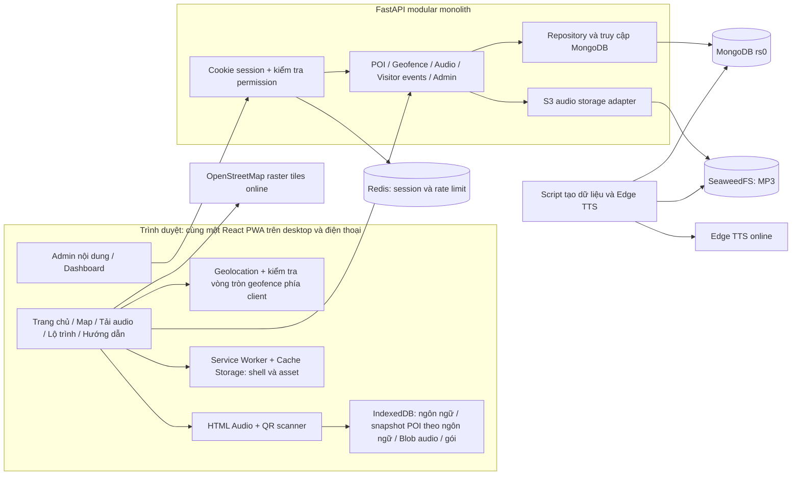
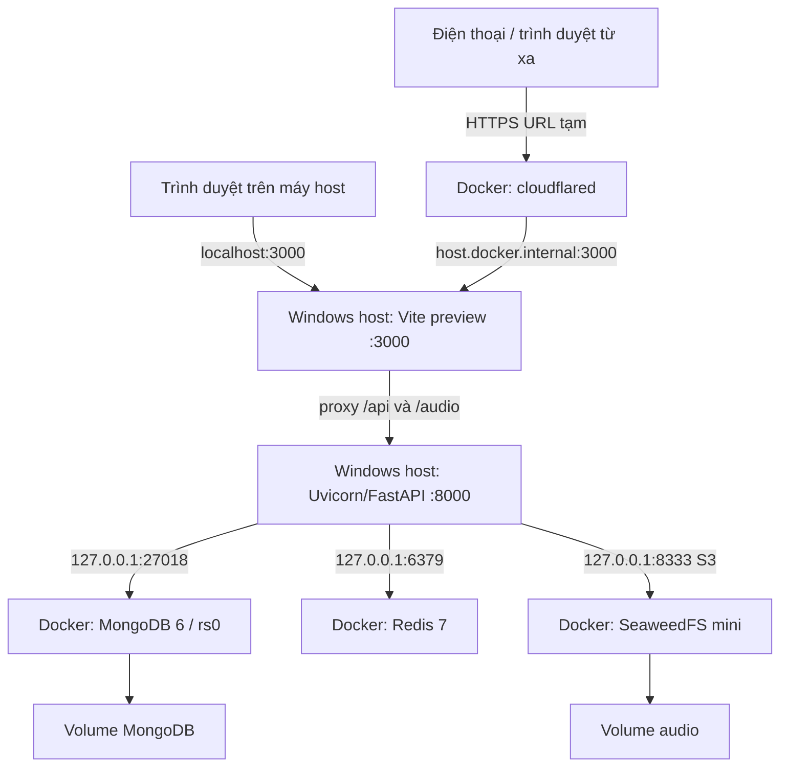
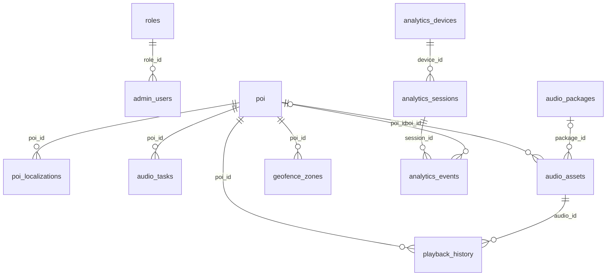

# Kiến trúc và mô hình dữ liệu đang triển khai

Cập nhật qua audit ngày 21/10/2026. Đây là mô tả **as-built** của bản demo, không phải đề xuất đổi kiến trúc.

## Thứ tự đọc và giải quyết khác biệt

1. Các quyết định đã được người dùng chấp thuận: bản mô phỏng lớp học; BSON ObjectId; cookie HTTP-only/Redis; visitor ẩn danh; 6 ngôn ngữ; TTS demo; HTTPS tunnel.
2. `README.md`: 10 use case gốc, mô tả yêu cầu mục tiêu.
3. Tài liệu này và `REQUIREMENTS_TRACEABILITY.md`: cấu trúc thực tế và phần chưa đạt đầy đủ mục tiêu.
4. `IMPLEMENTATION_PLAN.md`: kế hoạch công việc, không phải bằng chứng mọi task đã xong.
5. `HUONG_DAN_CAI_DAT_VA_BAN_GIAO.md`: vận hành và chuyển máy.

Ba ảnh `Component_Diagram.png`, `Deployment_Diagram.png`, `Logical_ERD.png` đã chuyển từ thư mục gốc vào [khu lưu trữ](archive/pre-audit-2026-10-21/README.md). Chúng là **bản thiết kế lịch sử, không dùng để mô tả runtime hiện tại**. Ảnh ERD còn lỗi chữ/nhãn: khối asset bị ghi trùng `audio_packages`, quan hệ task→package không có khóa tương ứng; các khối runtime/metrics không phản ánh đường ghi dữ liệu hiện tại. Sơ đồ Mermaid dưới đây thay thế chúng trong báo cáo kỹ thuật hiện tại. Không suy ra collection hoặc quan hệ mới từ ảnh cũ.

## 1. Component thực tế

- Chỉ có **một backend**, không phải các microservice triển khai độc lập.
- Admin và visitor là các route của cùng frontend, không có frontend offline riêng.
- TTS hiện chạy bằng script chuẩn bị dữ liệu. API audio task quản lý metadata/trạng thái, chưa có worker tự tạo TTS khi khách gặp audio thiếu.
- Chưa có adapter dịch tự động; nội dung 6 ngôn ngữ được nạp trước và sửa qua admin.
- Geofence được xét ở browser từ tọa độ GPS và vòng tròn server cung cấp. Không có dịch vụ theo dõi vị trí liên tục ở backend.
- Không có background sync/push notification hoặc PMTiles trong bản hiện tại.

## 2. Deployment thực tế

Frontend và backend chưa nằm trong Docker; file compose cũ không phải cấu hình chạy bản demo này. Compass chỉ là công cụ kết nối MongoDB. URL tunnel không phải nơi lưu database/audio và đổi khi khởi tạo tunnel mới.

## 3. Quan hệ dữ liệu thực tế

MongoDB lưu khóa `_id` và các tham chiếu nội bộ bằng **BSON ObjectId**. API dùng chuỗi hex 24 ký tự tên `id`; đây là serialization, không phải chuyển database sang String. `language_code` là mã ngôn ngữ dạng string.

| Collection | Field/ý nghĩa quan trọng |
|---|---|
| `roles` | `name`, `permissions[]` |
| `admin_users` | `username`, `email`, `password_hash`, `role_id`, `is_active` |
| `poi` | `name`, `description`, `category`, tọa độ, GeoJSON Point, ảnh, trạng thái; metadata nguồn/demo là phần mở rộng |
| `poi_localizations` | `poi_id`, `language_code`, `title`, `description`, `audio_url`, trạng thái biên tập/audio |
| `audio_tasks` | `poi_id`, `language_code`, `type`, `status`, `file_url`; không phải bản thu phát trực tiếp |
| `audio_assets` | `poi_id`, `language_code`, `package_id` tùy chọn, `file_url`, `checksum`, `duration`, `size_bytes` |
| `audio_packages` | một ngôn ngữ mỗi gói; manifest được API dựng từ asset, không phải ZIP vật lý |
| `geofence_zones` | `poi_id`, `zone_type=circle`, `geometry`, `radius`, `is_active`; hiện demo dùng 35 m |
| `analytics_devices` | `_id` là mã thiết bị ẩn danh từ browser |
| `analytics_sessions` | `device_id`, `user_id` ẩn danh, thời điểm, ngôn ngữ ban đầu |
| `analytics_events` | `session_id`, `event_type`, `poi_id` tùy chọn, `data.language_code`, `timestamp` |
| `playback_history` | bản ghi khi nghe hoàn tất có POI và audio ID; visitor `user_id` là định danh, không trỏ `admin_users` |
| `location_events` | sự kiện geofence, vị trí và visitor ID, không phải tuyến đường liên tục |

Không có collection visitor `users`. `user_id` ẩn danh không phải foreign key tới tài khoản quản trị. `audit_logs`, `analytics_metrics`, `runtime_location`, collection `languages` trong thiết kế gốc chưa có đường ghi/sử dụng runtime đầy đủ; không mô tả chúng như đã triển khai.

## 4. Quy tắc nhất quán đã kiểm tra/sửa

- POI chuyển vị trí: cập nhật cả GeoJSON của POI và tâm các geofence hình tròn của POI.
- Sửa nội dung dịch: audio cũ không còn được resolve như audio khớp nội dung mới. Phải tạo/đăng ký audio mới; hiện chưa có nút tái sinh TTS tự động trong admin.
- Gói offline đã tạo/tải là snapshot. Nó không tự cập nhật theo bản dịch mới; muốn phát hành bản mới phải chuẩn bị/gán lại audio và tải lại. Không xóa các MP3 cũ chỉ vì sửa bản dịch.
- POI cache được tách theo ngôn ngữ, không lấy bản dịch ngôn ngữ khác làm fallback ngầm.
- Tải gói phải đủ asset; kiểm tra byte size và SHA-256 của file tải về. Lỗi/hủy thì khôi phục các record trước đó.
- Analytics theo ngôn ngữ lấy từ **sự kiện**, không từ ngôn ngữ khởi đầu phiên.
- Chỉ số visits và biểu đồ visits đều đếm session start. Các mốc ngày/giờ dùng UTC và giao diện ghi rõ.
- Thiết bị hoạt động là ước tính có sự kiện trong 5 phút, không phải số người thực tại vườn thú.
- Tỷ lệ hoàn tất theo các sự kiện trong ngày, không phải phân tích cohort; nghe bắt đầu hôm trước/hoàn tất hôm sau có thể làm chỉ số lệch.

## 5. Giới hạn cần giữ đúng trong thuyết minh

Nghe offline yêu cầu tải trước trên cùng origin/browser. Bản đồ nền OSM phụ thuộc mạng; shell, POI và audio đã lưu vẫn dùng được, nhưng chưa có bản đồ nền offline hoàn chỉnh. GPS thật, autoplay nền và camera còn phụ thuộc thiết bị/quyền của trình duyệt; nút mô phỏng là cách kiểm chứng trong lớp, không chứng minh độ chính xác thực địa.
