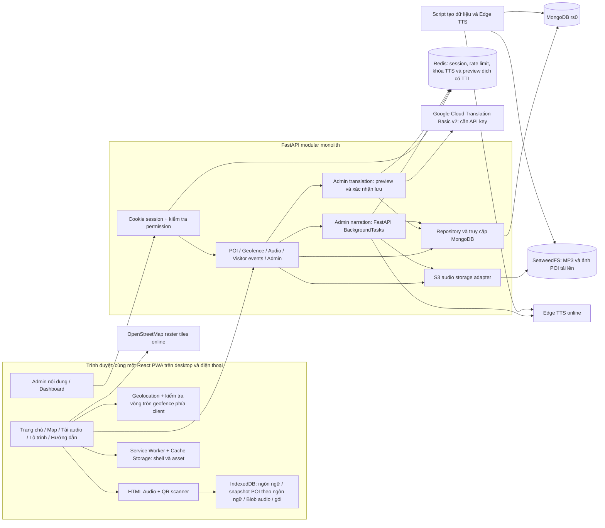
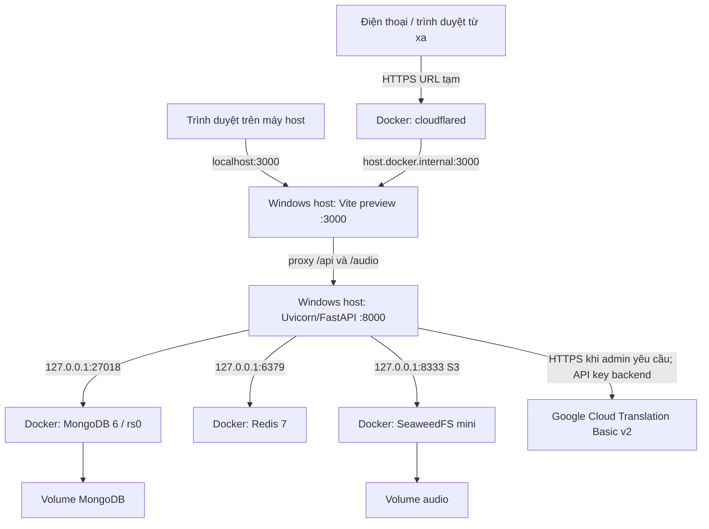
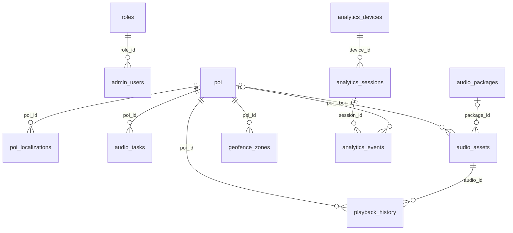

# Kiến trúc và mô hình dữ liệu đang triển khai

Cập nhật luồng admin/dịch ngày 09/11/2026; audit nền ngày 21/10/2026. Đây là mô tả **as-built** của bản demo. Hướng dẫn: [ADMIN_POI_WORKFLOW.md](ADMIN_POI_WORKFLOW.md), [ADMIN_AUTO_TRANSLATION.md](ADMIN_AUTO_TRANSLATION.md). Adapter dịch cần API key riêng; chưa nghiệm thu gọi dịch thật trong lần bổ sung này.

## Thứ tự đọc và giải quyết khác biệt

1. Các quyết định đã được người dùng chấp thuận: bản mô phỏng lớp học; BSON ObjectId; cookie HTTP-only/Redis; visitor ẩn danh; 6 ngôn ngữ; TTS demo; HTTPS tunnel.
2. `README.md`: 10 use case gốc, mô tả yêu cầu mục tiêu.
3. Tài liệu này và `REQUIREMENTS_TRACEABILITY.md`: cấu trúc thực tế và phần chưa đạt đầy đủ mục tiêu.
4. `IMPLEMENTATION_PLAN.md`: kế hoạch công việc, không phải bằng chứng mọi task đã xong.
5. `HUONG_DAN_CAI_DAT_VA_BAN_GIAO.md`: vận hành và chuyển máy.

Ba ảnh `Component_Diagram.png`, `Deployment_Diagram.png`, `Logical_ERD.png` đã chuyển từ thư mục gốc vào [khu lưu trữ](archive/pre-audit-2026-10-21/README.md). Chúng là **bản thiết kế lịch sử, không dùng để mô tả runtime hiện tại**. Ảnh ERD còn lỗi chữ/nhãn: khối asset bị ghi trùng `audio_packages`, quan hệ task→package không có khóa tương ứng; các khối runtime/metrics không phản ánh đường ghi dữ liệu hiện tại. Sơ đồ Mermaid dưới đây thay thế chúng trong báo cáo kỹ thuật hiện tại. Không suy ra collection hoặc quan hệ mới từ ảnh cũ.

## 1. Component thực tế

- Chỉ có **một backend**, không phải các microservice triển khai độc lập.
- Admin và visitor là các route của cùng frontend, không có frontend offline riêng.
- Admin có thể lưu nội dung rồi yêu cầu tạo TTS cho từng ngôn ngữ; tác vụ chạy trong process FastAPI bằng `BackgroundTasks`, dùng Redis khóa trùng 5 phút. Không có worker/queue bền vững và không tự tạo TTS khi khách gặp audio thiếu. Script seed vẫn có thể chuẩn bị dữ liệu ban đầu.
- Ảnh JPEG/PNG/WebP được kiểm tra phía server, tối đa 5 MB/16 megapixel, lưu SeaweedFS và phục vụ qua `/api/media/pois/...`; không lưu binary ảnh trong MongoDB.
- Admin lưu vùng geofence tròn với bán kính 5–500 m. Gói tạo qua giao diện admin mới là snapshot các bản thu sẵn sàng của POI đang hiển thị, một ngôn ngữ/gói; tạo lại TTS không sửa membership/file của snapshot cũ.
- Adapter dịch Google Cloud Basic v2 dịch title/description nguồn đã lưu sang 5 ngôn ngữ khác. Preview Redis 30 phút, admin xem/sửa/chọn/xác nhận trước commit; kiểm tra nguồn và revision bản đích trong transaction MongoDB. Cần `GOOGLE_TRANSLATE_API_KEY`; chưa cấu hình vẫn nhập thủ công. Không tự gọi dịch khi khách xem POI hoặc khi chạy TTS.
- Geofence được xét ở browser từ tọa độ GPS và vòng tròn server cung cấp. Không có dịch vụ theo dõi vị trí liên tục ở backend.
- Không có background sync/push notification hoặc PMTiles trong bản hiện tại.

## 2. Deployment thực tế

Frontend và backend chưa nằm trong Docker; file compose cũ không phải cấu hình chạy bản demo này. Compass chỉ là công cụ kết nối MongoDB. URL tunnel không phải nơi lưu database/audio và đổi khi khởi tạo tunnel mới.

## 3. Quan hệ dữ liệu thực tế

MongoDB lưu khóa `_id` và các tham chiếu nội bộ bằng **BSON ObjectId**. API dùng chuỗi hex 24 ký tự tên `id`; đây là serialization, không phải chuyển database sang String. `language_code` là mã ngôn ngữ dạng string.

| Collection | Field/ý nghĩa quan trọng |
|---|---|
| `roles` | `name`, `permissions[]` |
| `admin_users` | `username`, `email`, `password_hash`, `role_id`, `is_active` |
| `poi` | `name`, `description`, `category`, tọa độ, GeoJSON Point, ảnh, trạng thái; metadata nguồn/demo là phần mở rộng |
| `poi_localizations` | `poi_id`, `language_code`, `title`, `description`, `audio_url`, trạng thái biên tập/audio |
| `audio_tasks` | `poi_id`, `language_code`, `type`, `status`, `file_url`; không phải bản thu phát trực tiếp |
| `audio_assets` | `poi_id`, `language_code`, `package_id` tùy chọn, `file_url`, `checksum`, `duration`, `size_bytes` |
| `audio_packages` | một ngôn ngữ mỗi gói; manifest được API dựng từ asset, không phải ZIP vật lý |
| `geofence_zones` | `poi_id`, `zone_type=circle`, `geometry`, `radius`, `is_active`; hiện demo dùng 35 m |
| `analytics_devices` | `_id` là mã thiết bị ẩn danh từ browser |
| `analytics_sessions` | `device_id`, `user_id` ẩn danh, thời điểm, ngôn ngữ ban đầu |
| `analytics_events` | `session_id`, `event_type`, `poi_id` tùy chọn, `data.language_code`, `timestamp` |
| `playback_history` | bản ghi khi nghe hoàn tất có POI và audio ID; visitor `user_id` là định danh, không trỏ `admin_users` |
| `location_events` | sự kiện geofence, vị trí và visitor ID, không phải tuyến đường liên tục |

### Mở rộng cho luồng admin 04/11/2026

- Không thêm collection hay đổi kiểu khóa. `poi.scientific_name` là tên khoa học; `image_url` có thể trỏ ảnh upload. POI tạo từ admin mặc định `is_active=false`.
- `poi_localizations.tts_task_id` tham chiếu ObjectId của tác vụ hiện tại; thay title/description sẽ bỏ liên kết audio/task cũ. Chỉ tác vụ khớp task ID và nội dung hiện tại mới được gắn audio mới.
- `audio_tasks` có thêm `voice`, `source_title`, `source_text`, `error_message`. Trạng thái: Pending → Processing → Completed/Failed. Tác vụ gián đoạn được nhận diện khi admin truy vấn trạng thái sau 5 phút; phải yêu cầu tạo lại.
- `audio_assets.source_task_id` tham chiếu tác vụ TTS; bản thu gốc có `package_id=null`. Gói snapshot sao chép metadata asset với ObjectId riêng, cùng file bất biến, `is_snapshot=true`; `audio_packages.is_snapshot=true` chặn gán lại membership qua API cũ.
- Snapshot cố định **audio**, không đóng băng toàn bộ tên/mô tả/ảnh POI; client tải metadata POI tại thời điểm tải gói. Gói legacy vẫn được đọc bình thường.

### Mở rộng dịch tự động 09/11/2026

- Không thêm collection/quan hệ hoặc đổi ObjectId. Metadata tùy chọn `poi_localizations.translation` gồm `source_language`, `source_hash`, `provider`, `translated_at`, `review_status`; nguồn có `translation_guard` phục vụ write conflict trong transaction. Chi tiết nằm trong hướng dẫn dịch.
- Preview chỉ ở Redis, gắn admin/POI, TTL 30 phút; mỗi admin tối đa một batch dịch/30 giây. Các bản thành công có thể lưu trước, lỗi có thể thử lại. Mỗi nhóm preview commit toàn bộ hoặc không commit; các nhóm từ retry được lưu tuần tự.
- Commit bảo đảm index unique `(poi_id,language_code)`; tạo index nếu chưa có, từ chối nếu dữ liệu trùng thay vì tự xóa. Transaction cần replica set hiện tại. So khớp nguồn, revision và xác nhận thay thế để tránh ghi đè nội dung mới của admin khác.
- Sửa nguồn đánh dấu bản dịch phụ thuộc `needs_review`; không tự đổi lời hoặc audio đích. Khi lưu thay đổi lời đích mới vô hiệu audio của đích. Preview chưa công khai; sau xác nhận lưu, POI active có thể được khách đọc ngay. Audio/gói offline vẫn theo luồng cũ.

Không có collection visitor `users`. `user_id` ẩn danh không phải foreign key tới tài khoản quản trị. `audit_logs`, `analytics_metrics`, `runtime_location`, collection `languages` trong thiết kế gốc chưa có đường ghi/sử dụng runtime đầy đủ; không mô tả chúng như đã triển khai.

## 4. Quy tắc nhất quán đã kiểm tra/sửa

- POI chuyển vị trí: cập nhật cả GeoJSON của POI và tâm các geofence hình tròn của POI.
- Sửa nội dung dịch: audio cũ không còn được resolve như audio khớp nội dung mới. Dùng nút lưu và tạo audio trong admin để tạo lại, chờ Completed rồi nghe thử.
- Gói snapshot đã phát hành/tải không tự cập nhật theo bản dịch mới; phát hành gói mới và tải lại để nhận audio mới. Gói legacy vẫn được giữ và có API gán asset cũ. Không xóa các MP3 cũ chỉ vì sửa bản dịch.
- POI cache được tách theo ngôn ngữ, không lấy bản dịch ngôn ngữ khác làm fallback ngầm.
- Tải gói phải đủ asset; kiểm tra byte size và SHA-256 của file tải về. Lỗi/hủy thì khôi phục các record trước đó.
- Analytics theo ngôn ngữ lấy từ **sự kiện**, không từ ngôn ngữ khởi đầu phiên.
- Chỉ số visits và biểu đồ visits đều đếm session start. Các mốc ngày/giờ dùng UTC và giao diện ghi rõ.
- Thiết bị hoạt động là ước tính có sự kiện trong 5 phút, không phải số người thực tại vườn thú.
- Tỷ lệ hoàn tất theo các sự kiện trong ngày, không phải phân tích cohort; nghe bắt đầu hôm trước/hoàn tất hôm sau có thể làm chỉ số lệch.

## 5. Giới hạn cần giữ đúng trong thuyết minh

Nghe offline yêu cầu tải trước trên cùng origin/browser. Bản đồ nền OSM phụ thuộc mạng; shell, POI và audio đã lưu vẫn dùng được, nhưng chưa có bản đồ nền offline hoàn chỉnh. GPS thật, autoplay nền và camera còn phụ thuộc thiết bị/quyền của trình duyệt; nút mô phỏng là cách kiểm chứng trong lớp, không chứng minh độ chính xác thực địa.
