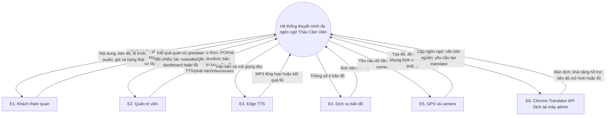
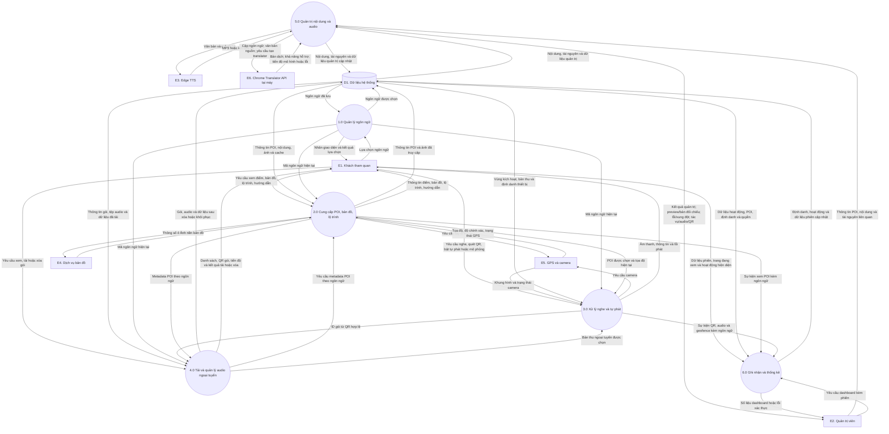
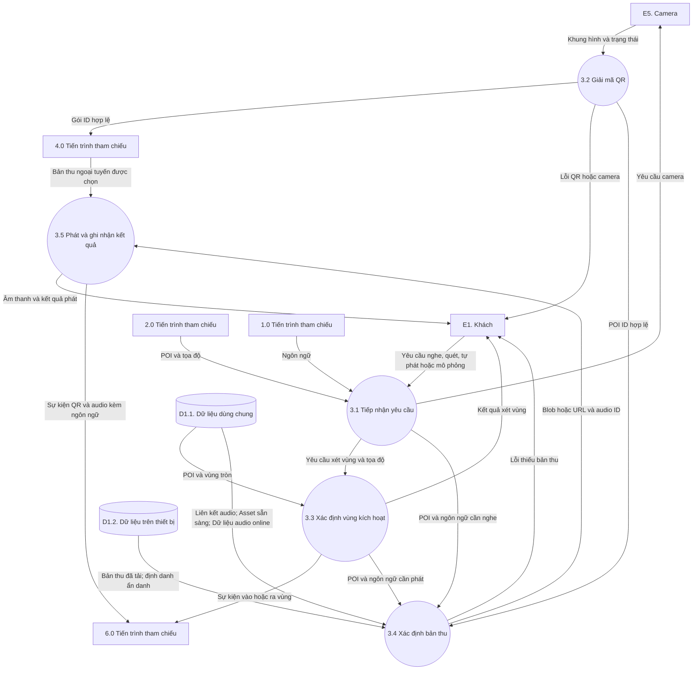
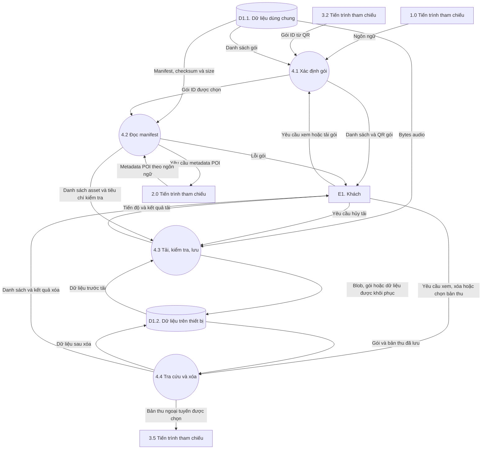
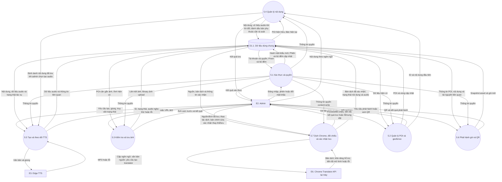
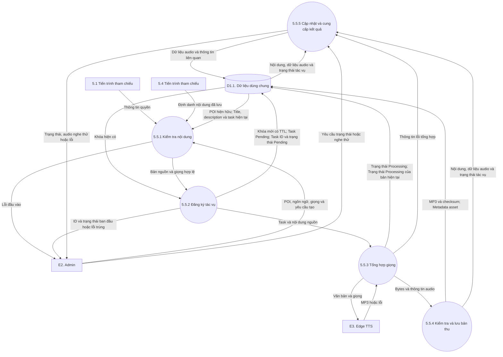
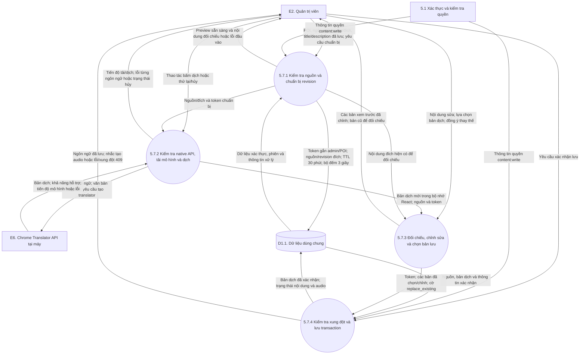
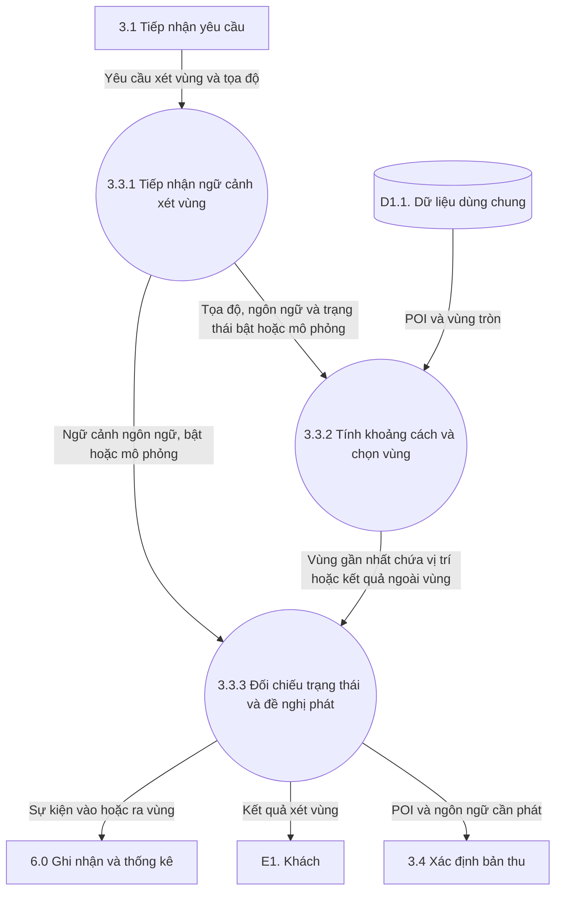
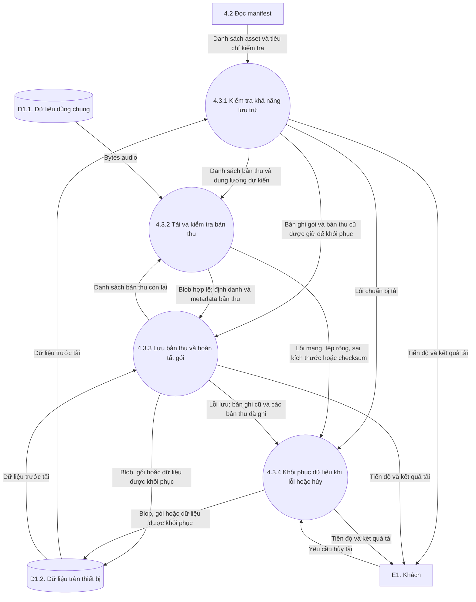

# BÁO CÁO PHÂN TÍCH LUỒNG DỮ LIỆU HỆ THỐNG THUYẾT MINH ĐA NGÔN NGỮ THẢO CẦM VIÊN

**Ngày cập nhật trình bày:** 10/11/2026; logic Chrome đối chiếu 09/11/2026, bổ sung mức 2 đối chiếu mã hiện tại

**Phiên bản code tham chiếu:** `fb1b0b8` — nhánh `feature/admin-auto-translation`; người dùng đã nghiệm thu luồng Chrome

**Phạm vi:** React PWA dành cho khách và quản trị viên; FastAPI; MongoDB; Redis; SeaweedFS; dữ liệu ngoại tuyến trong trình duyệt.

## 1. Mục đích và quy ước

Báo cáo đặc tả dữ liệu đi vào, được xử lý, lưu trữ và trả ra trong hệ thống đang triển khai. Use case là đầu vào để xác định các xử lý nghiệp vụ; bảng truy vết ở cuối tài liệu liên kết tiến trình với module/API/hàm để hỗ trợ kiểm soát thay đổi code.

### 1.1. Quy ước các mức theo tài liệu môn học

| Cấp | Nội dung | Cách đánh số trong báo cáo |
|---|---|---|
| Sơ đồ ngữ cảnh | Toàn hệ thống là một tiến trình; thể hiện trao đổi với bên ngoài | `Hệ thống thuyết minh đa ngôn ngữ Thảo Cầm Viên` |
| Mức 0 | Phân rã hệ thống thành các tiến trình nghiệp vụ chính và kho dữ liệu | `1.0` đến `6.0` |
| Mức 1 | Phân rã một tiến trình của mức 0 | Ví dụ `5.1` đến `5.7` thuộc `5.0` |
| Mức 2 | Phân rã một tiến trình của mức 1 khi cần chi tiết | `3.3.1`–`3.3.3` xét vùng; `4.3.1`–`4.3.4` tải gói; `5.5.1`–`5.5.5` TTS; `5.7.1`–`5.7.4` dịch Chrome |

Trong báo cáo này, sơ đồ ngữ cảnh được trình bày riêng trước mức 0. Mỗi sơ đồ mức 1 phải ghi rõ tiến trình cha; mỗi sơ đồ mức 2 phải ghi rõ tiến trình cha của mức 1.

### 1.2. Cách đọc ký hiệu

- **Tác nhân ngoài:** cung cấp hoặc nhận dữ liệu qua ranh giới hệ thống.
- **Tiến trình:** tên theo dạng động từ + đối tượng được xử lý.
- **Kho dữ liệu:** dữ liệu được giữ lại để sử dụng; tên theo danh từ.
- **Dòng dữ liệu:** mũi tên một chiều có tên dữ liệu cụ thể. Hai chiều được biểu diễn bằng hai mũi tên có nhãn riêng.
- Các sơ đồ Mermaid dưới đây là bản minh họa và đặc tả để dựng lại bằng công cụ vẽ. Khi nộp bài, dùng thống nhất bộ ký hiệu DFD thầy yêu cầu, chẳng hạn Yourdon–DeMarco hoặc Gane–Sarson. Hình kho dữ liệu trong Mermaid chỉ biểu thị kho logic.

DFD mô tả quan hệ xử lý dữ liệu. Thứ tự thực thi, điều kiện rẽ nhánh, vòng lặp, retry và trình tự bất đồng bộ được diễn giải trong đặc tả tiến trình; khi cần có thể bổ sung activity/sequence diagram.

## 2. Ranh giới hệ thống và tác nhân ngoài

Frontend React, backend FastAPI và các kho lưu trữ do đồ án quản lý nằm trong phạm vi hệ thống. Việc xử lý ở frontend vẫn là tiến trình nội bộ của hệ thống.

| Mã | Tác nhân ngoài | Dữ liệu cung cấp | Dữ liệu nhận |
|---|---|---|---|
| E1 | Khách tham quan | Ngôn ngữ; yêu cầu xem POI/bản đồ/lộ trình/hướng dẫn; yêu cầu quét QR, nghe, bật tự phát, tải/xóa gói; thao tác sử dụng | Nội dung đa ngôn ngữ; thông tin POI; bản đồ/lộ trình; âm thanh; thông tin gói; trạng thái và thông báo lỗi |
| E2 | Quản trị viên | Thông tin đăng nhập/phiên; dữ liệu POI, tọa độ, bán kính, ảnh, nội dung từng ngôn ngữ; lựa chọn giọng; yêu cầu tạo audio/phát hành gói/xem thống kê | Kết quả đăng nhập và lưu; nội dung quản lý; trạng thái tác vụ; audio nghe thử; gói/QR; số liệu dashboard |
| E6 | Chrome Translator API tại máy | Bản dịch; khả năng hỗ trợ; tiến độ mô hình/lỗi | Cặp ngôn ngữ; văn bản nguồn; yêu cầu tạo translator từ nút bấm admin |
| E3 | Dịch vụ Edge TTS | MP3 tổng hợp hoặc kết quả lỗi | Văn bản cần đọc, mã giọng đọc |
| E4 | Dịch vụ bản đồ OpenStreetMap | Ảnh nền bản đồ raster | Thông số yêu cầu ô bản đồ |
| E5 | Dịch vụ thiết bị của trình duyệt/hệ điều hành | Tọa độ GPS, độ chính xác; khung hình camera; trạng thái quyền/lỗi thiết bị | Yêu cầu lấy vị trí hoặc hình ảnh camera |

E6 là dịch vụ native của trình duyệt, không phải dịch vụ Cloud và không phải tiến trình của FastAPI. App chỉ gọi API, còn mô hình do Chrome tải/quản lý; không coi mô hình là gói audio D9. E5 biểu diễn dịch vụ GPS/camera bên ngoài mã ứng dụng; các hook geolocation, thư viện giải mã QR và MapLibre thuộc phần xử lý nội bộ. Nếu mẫu bài của thầy gộp nguồn thiết bị vào khách tham quan, có thể gộp E5 vào E1 và giữ nguyên các dòng dữ liệu tương ứng ở mọi mức.

Cloudflare tunnel, HTTP proxy, Docker, Uvicorn và cổng mạng được mô tả trong deployment diagram. Các thành phần này không tạo thêm tác nhân nghiệp vụ trong DFD này. Seeder/backup là công cụ vận hành ngoài các luồng sử dụng thường ngày, được loại khỏi phạm vi phân rã chức năng của báo cáo.

## 3. Sơ đồ ngữ cảnh

Ở sơ đồ ngữ cảnh, các kho MongoDB, Redis, SeaweedFS và bộ nhớ trình duyệt được bao hàm trong tiến trình hệ thống.

## 4. Kho dữ liệu khái quát

| Mã | Kho logic | Phạm vi |
|---|---|---|
| D1 | Dữ liệu hệ thống | Kho chung trên sơ đồ mức 0, bao gồm dữ liệu dùng chung và dữ liệu trên thiết bị |
| D1.1 | Dữ liệu dùng chung | Nội dung, tài nguyên, quản trị, dữ liệu tạm và hoạt động do hệ thống quản lý |
| D1.2 | Dữ liệu trên thiết bị | Lựa chọn ngôn ngữ, định danh, cache POI/ảnh, gói và audio đã tải |

Ở mức 0 chỉ dùng **D1**. Mức 1 và mức 2 chỉ hiện **D1.1/D1.2** khi tiến trình cần sử dụng. Không liệt kê collection, trường hay công nghệ trong ký hiệu kho. Mỗi kho chỉ xuất hiện một lần trong từng hình; các tiến trình cùng nối đến ký hiệu kho đó. Việc tách D1 thành D1.1/D1.2 là phân nhóm logic, không tạo hay đổi database.

Chi tiết MongoDB, Redis, SeaweedFS và lưu trữ trình duyệt nằm trong [bảng đối chiếu kỹ thuật riêng](DFD_XML/KHO_DU_LIEU_DOI_CHIEU.md). Việc tách bộ nhớ thiết bị giúp giải thích nghe offline; dữ liệu dịch chưa xác nhận chỉ ở bộ nhớ làm việc của form, không phải gói ngoại tuyến.

MongoDB dùng BSON ObjectId cho khóa và tham chiếu nội bộ; API truyền chuỗi hex 24 ký tự. Khách sử dụng định danh ẩn danh riêng.

## 5. DFD mức 0 — Hệ thống thuyết minh đa ngôn ngữ Thảo Cầm Viên

### 5.1. Các tiến trình chính

| Mã | Tiến trình | Phạm vi và liên hệ use case |
|---|---|---|
| 1.0 | Quản lý lựa chọn ngôn ngữ | Chọn, kiểm tra, lưu/khôi phục ngôn ngữ, cung cấp nhãn giao diện và mã ngôn ngữ cho các xử lý khác — UC-01 |
| 2.0 | Cung cấp POI, bản đồ và lộ trình gợi ý | Catalog/chi tiết loài, tọa độ, bản đồ, gần nhất, danh sách điểm gợi ý, nội dung hướng dẫn — UC-02 và các trang bổ sung |
| 3.0 | Xử lý yêu cầu nghe và tự phát thuyết minh | Quét/giải mã QR, chọn audio, phát theo yêu cầu, xét geofence, phát theo GPS hoặc mô phỏng — UC-03, UC-04; phần phát của UC-06 |
| 4.0 | Tải và quản lý audio ngoại tuyến | Danh sách gói/QR, manifest, tải/kiểm tra/lưu, tra cứu/xóa gói; cung cấp bản thu đã tải cho 3.0 — UC-05, UC-06 |
| 5.0 | Quản trị nội dung và phát hành audio | Xác thực, POI/geofence/ảnh, nội dung từng ngôn ngữ; Chrome preview/đối chiếu/xác nhận; TTS, nghe thử, snapshot và QR — UC-07, UC-08, UC-09 |
| 6.0 | Ghi nhận hoạt động và cung cấp thống kê | Thu nhận sự kiện, định danh ẩn danh, lịch sử nghe/vị trí, tổng hợp dashboard có kiểm tra quyền — UC-10 |

Phần phát Blob ngoại tuyến được quy về 3.0 để thống nhất trách nhiệm phát audio. Tiến trình 4.0 quản lý bản thu đã tải và chuyển bản thu được chọn sang 3.0. Đây là cách phân rã logic; code có thể nằm cùng một component React.

### 5.2. Sơ đồ mức 0

Bộ hình hiện tại không lặp ký hiệu kho hoặc tác nhân trong cùng một sơ đồ. Các đường nối vuông góc được sắp lại để dùng chung kho; nhãn ngắn trên hình được giải thích đầy đủ trong bảng luồng riêng. Chỉ giữ tiêu đề và nội dung DFD trên ảnh, không chèn ngày cập nhật hoặc chú thích cuối hình.

Trang chủ có thẻ QR gói: phần hiển thị được đặt tại trang chủ về mặt UI, nhưng dữ liệu gói/QR vẫn thuộc tiến trình 4.0. Nhãn giao diện và nội dung hướng dẫn tĩnh được lấy từ tài nguyên đóng gói của ứng dụng; chúng không cần collection bản dịch giao diện riêng.

## 6. DFD mức 1 — Phân rã sáu tiến trình mức 0

Các bảng dưới đây là đặc tả đầy đủ để dựng sáu sơ đồ mức 1. Giữ nguyên E1–E6; D1 của mức cha được chi tiết thành D1.1/D1.2, chỉ hiện kho thực sự liên quan.

### 6.1. Phân rã 1.0 — Quản lý lựa chọn ngôn ngữ

| Mã | Xử lý | Đầu vào và nơi đọc | Đầu ra và nơi nhận |
|---|---|---|---|
| 1.1 | Khôi phục lựa chọn | Ngôn ngữ từ D1.2 hoặc trạng thái chưa chọn | Mã ngôn ngữ khôi phục cho 1.2 |
| 1.2 | Kiểm tra ngôn ngữ | Lựa chọn E1 hoặc mã từ 1.1; danh sách mã hỗ trợ trong ứng dụng | Ngôn ngữ hợp lệ cho 1.3/1.4; kết quả cần chọn lại cho E1 |
| 1.3 | Lưu lựa chọn | Mã hợp lệ từ 1.2 | Giá trị lưu vào IndexedDB/localStorage thuộc D1.2; kết quả lưu cho E1 |
| 1.4 | Cung cấp ngữ cảnh ngôn ngữ | Mã hợp lệ; tài nguyên nhãn giao diện đóng gói | Nhãn cho E1; mã hiện tại cho 2.0, 3.0, 4.0 |

Sáu mã hiện có: `vi`, `en`, `fr`, `zh-Hans`, `ja`, `ko`. Đổi ngôn ngữ giao diện không tự tạo bản dịch hoặc MP3; các tiến trình đọc nội dung phải dùng mã ngôn ngữ tương ứng.

### 6.2. Phân rã 2.0 — Cung cấp POI, bản đồ và lộ trình gợi ý

| Mã | Xử lý | Đầu vào và nơi đọc | Đầu ra và nơi nhận |
|---|---|---|---|
| 2.1 | Tiếp nhận nhu cầu tra cứu | Yêu cầu E1, ngôn ngữ từ 1.0; yêu cầu metadata từ 4.0 | Tiêu chí POI/ngôn ngữ cho 2.2; nhu cầu hiển thị cho 2.3/2.4 |
| 2.2 | Tải và khôi phục dữ liệu POI | POI đang hiển thị D1.1, bản ngôn ngữ D1.1; snapshot D1.2 khi phù hợp | POI đúng ngôn ngữ cho 2.3/2.4 và 4.0; snapshot mới vào D1.2; lỗi cho E1 |
| 2.3 | Cung cấp thông tin và bản đồ | Dữ liệu 2.2; ảnh D1.1/D1.2; tọa độ và trạng thái GPS từ E5; ảnh nền E4 | Nội dung/marker/điểm gần nhất cho E1; yêu cầu ô bản đồ tới E4; yêu cầu vị trí tới E5; ảnh đã truy cập vào D1.2; POI/tọa độ cho 3.0; sự kiện xem POI cho 6.0 |
| 2.4 | Cung cấp lộ trình gợi ý và hướng dẫn | POI 2.2; yêu cầu E1; cấu hình lộ trình/nội dung tĩnh trong ứng dụng | Danh sách điểm gợi ý, liên kết tới bản đồ và hướng dẫn cho E1 |

`/api/pois` và catalog lấy POI đang hiển thị có bản ngôn ngữ tương ứng. Hiện lộ trình chọn các điểm đầu danh sách với các cấu hình 3/5/8 điểm và ước tính thời gian; chưa tối ưu đường đi. POI đã cache có thể được khôi phục theo từng ngôn ngữ; nền bản đồ OSM phụ thuộc kết nối mạng.

### 6.3. Phân rã 3.0 — Xử lý yêu cầu nghe và tự phát thuyết minh

| Mã | Xử lý | Đầu vào và nơi đọc | Đầu ra và nơi nhận |
|---|---|---|---|
| 3.1 | Tiếp nhận yêu cầu nghe/quét | Yêu cầu E1; POI/tọa độ từ 2.0; ngôn ngữ 1.0; bản thu được chọn từ 4.0 | Yêu cầu camera tới E5; khung hình tới 3.2; yêu cầu xét vùng tới 3.3; yêu cầu tìm/phát tới 3.4/3.5 |
| 3.2 | Giải mã và kiểm tra QR | Khung hình/trạng thái camera E5; payload QR | POI ID hợp lệ cho 3.4; gói ID hợp lệ cho 4.0; lỗi cho E1; dữ liệu QR POI hợp lệ đi cùng kết quả nghe để ghi sự kiện |
| 3.3 | Xác định POI trong vùng kích hoạt | Tọa độ từ 2.0, trạng thái bật/mô phỏng từ E1, POI và geofence D1.1 | POI/ngôn ngữ cần phát cho 3.4; kết quả xét vùng cho E1; sự kiện vào/ra vùng cho 6.0 |
| 3.4 | Xác định bản thu có thể phát | POI/ngôn ngữ từ 3.1/3.2/3.3; bản thu D1.2; liên kết D1.1; asset D1.1; MP3 D1.1 | Blob/URL cùng audio ID cho 3.5; lỗi thiếu audio cho E1 |
| 3.5 | Phát audio và ghi nhận kết quả | Bản thu từ 3.4 hoặc 4.0; thao tác E1 | Âm thanh/trạng thái/lỗi cho E1; sự kiện QR POI khi nghe, bắt đầu/hoàn tất audio cho 6.0 |

**Khác biệt phải giữ khi đối chiếu code:** nghe thủ công trên map/QR dùng `resolvePlayableAudio`, ưu tiên Blob tải sẵn. Nhánh tự phát theo GPS thật trong `InteractiveMap.jsx` hiện gọi API resolve/content trực tiếp; geofence cũng được tải từ server. Vì vậy chưa mô tả tự phát GPS thật như một luồng hoàn toàn ngoại tuyến. Mô phỏng đến POI dùng bản thu đã được chuẩn bị ở màn hình, không chứng minh khả năng GPS nền ngoài thực địa.

### 6.4. Phân rã 4.0 — Tải và quản lý audio ngoại tuyến

| Mã | Xử lý | Đầu vào và nơi đọc | Đầu ra và nơi nhận |
|---|---|---|---|
| 4.1 | Xác định gói cần sử dụng | Yêu cầu E1 hoặc gói ID từ 3.2; ngôn ngữ 1.0; danh sách gói D1.1 | Danh sách/QR gói cho E1; gói ID được chọn cho 4.2 |
| 4.2 | Đọc manifest và chuẩn bị tải | Gói ID; package/asset/checksum D1.1; yêu cầu và kết quả metadata qua 2.0 | Danh sách asset cần tải và thông tin kiểm tra cho 4.3; lỗi gói cho E1 |
| 4.3 | Tải, kiểm tra và lưu gói | Manifest 4.2; MP3 D1.1; bản ghi trước tải D1.2; yêu cầu hủy E1 | Blob và bản ghi gói vào D1.2; khôi phục dữ liệu cũ khi lỗi/hủy; tiến độ/kết quả cho E1 |
| 4.4 | Tra cứu và xóa dữ liệu đã tải | Gói/bản thu D1.2; yêu cầu E1 | Danh sách cho E1; dữ liệu sau xóa vào D1.2; bản thu được chọn cho 3.5 |

Gói là manifest cùng các asset, không phải file ZIP bắt buộc. Client kiểm tra kích thước và SHA-256 khi có checksum phù hợp; hỗ trợ hủy và khôi phục dữ liệu trước tải. Kho cục bộ gắn với origin/trình duyệt; đổi URL tunnel không chuyển cache sang URL mới. App shell được Service Worker phục vụ từ D1.2 khi đã cache; ảnh chỉ được bảo đảm theo những gì đã lưu, không mặc định mọi ảnh mới đều được tải cùng audio.

### 6.5. Phân rã 5.0 — Quản trị nội dung và phát hành audio

| Mã | Xử lý | Đầu vào và nơi đọc | Đầu ra và nơi nhận |
|---|---|---|---|
| 5.1 | Xác thực và kiểm tra quyền | Thông tin đăng nhập/phiên/yêu cầu đổi mật khẩu E2; tài khoản và quyền D1.1; phiên/bộ đếm D1.1 | Phiên và kết quả xác thực E2; phiên/bộ đếm D1.1; hash mới D1.1; thông tin quyền cho 5.2–5.7 |
| 5.2 | Quản lý POI và geofence | Dữ liệu POI/tọa độ/bán kính/trạng thái E2; dữ liệu hiện có D1.1; quyền từ 5.1 | POI/geofence cập nhật D1.1; kết quả E2; ID và bản ngôn ngữ đầu tiên cho 5.4 khi tạo POI |
| 5.3 | Kiểm tra và lưu ảnh | File ảnh hoặc URL E2; POI D1.1; quyền 5.1; ảnh hiện có D1.1 | File upload D1.1; `image_url` D1.1; ảnh xem trước/kết quả E2 |
| 5.4 | Quản lý nội dung theo ngôn ngữ | Title/description/ngôn ngữ E2 hoặc từ 5.2; POI D1.1; bản hiện tại D1.1; quyền 5.1 | Nội dung D1.1; hủy liên kết audio/task hiện tại khi lời đổi; kết quả E2; đánh dấu bản dịch phụ thuộc cần rà soát; định danh đã lưu cho 5.5 khi admin yêu cầu TTS |
| 5.5 | Tạo và theo dõi audio TTS | Yêu cầu tạo/giọng/truy vấn trạng thái E2; quyền 5.1; POI D1.1; nội dung D1.1; task D1.1; khóa D1.1; kết quả E3 | Yêu cầu văn bản/giọng E3; task/trạng thái D1.1; lease D1.1; MP3 D1.1; asset D1.1; liên kết audio hợp lệ D1.1; trạng thái/audio nghe thử E2 |
| 5.6 | Phát hành gói audio và QR | Yêu cầu gói/ngôn ngữ hoặc QR POI E2; quyền 5.1; POI D1.1; nội dung D1.1; asset/gói D1.1; metadata tệp D1.1 | Snapshot gói/asset D1.1; QR POI/gói và kết quả E2 |
| 5.7 | Dịch Chrome, đối chiếu và xác nhận lưu | Nguồn/đích, bản sửa và xác nhận E2; quyền 5.1; POI D1.1; nguồn/bản đích D1.1; token/revision D1.1; kết quả native E6 | Yêu cầu dịch E6; preview/kết quả/lỗi E2; token/nguồn/revision TTL 30 phút D1.1; transaction bản dịch/metadata và vô hiệu audio khi lời đổi D1.1 |

5.1 biểu diễn trách nhiệm kiểm tra quyền dùng chung. Các endpoint hiện tự gọi dependency kiểm tra quyền cho từng request; sơ đồ không yêu cầu frontend gọi một API kiểm tra quyền riêng trước mọi thao tác.

Lưu POI, upload ảnh và lưu geofence là các request riêng. Tạo POI kèm bản ngôn ngữ đầu tiên có xử lý xóa POI vừa tạo nếu bước ghi bản ngôn ngữ lỗi; toàn bộ các bước của form không phải một transaction chung. Không đưa cam kết rollback mọi bước vào DFD/đặc tả.

### 6.6. Phân rã 6.0 — Ghi nhận hoạt động và cung cấp thống kê

| Mã | Xử lý | Đầu vào và nơi đọc | Đầu ra và nơi nhận |
|---|---|---|---|
| 6.1 | Chuẩn bị định danh và dữ liệu sự kiện | Thao tác phiên/trang E1; sự kiện xem POI từ 2.0; QR/audio/geofence từ 3.0; định danh D1.2 | Định danh mới D1.2; payload gồm device/session/visitor, loại sự kiện, POI/audio, ngôn ngữ, thời điểm nhận phía server qua 6.2 |
| 6.2 | Kiểm tra và ghi nhận hoạt động | Payload 6.1; bộ đếm rate limit D1.1 | Thiết bị/phiên/sự kiện D1.1; playback history khi nghe hoàn tất; location event khi có sự kiện vùng và tọa độ; bộ đếm D1.1; kết quả tiếp nhận/lỗi cho 6.1 |
| 6.3 | Kiểm tra quyền xem phân tích | Yêu cầu dashboard kèm phiên E2; phiên D1.1; tài khoản/quyền D1.1 | Yêu cầu hợp lệ cho 6.4; lỗi xác thực/phân quyền E2 |
| 6.4 | Tổng hợp và cung cấp dashboard | Yêu cầu hợp lệ 6.3; dữ liệu D1.1; tên POI D1.1 | KPI, biểu đồ và bảng thống kê cho E2 |

6.3 dùng cùng dịch vụ xác thực với 5.1; đây là trách nhiệm xác thực tại ranh giới chức năng analytics, không tạo hệ thống tài khoản thứ hai. Ngôn ngữ thống kê lấy từ sự kiện đang xét, không lấy mặc định từ ngôn ngữ đầu phiên. Thiết bị hoạt động được ước tính theo cửa sổ 5 phút; số lượt truy cập lấy các phiên bắt đầu, mốc ngày/giờ dashboard dùng UTC. Hiện không có hàng đợi gửi bù analytics khi offline.

## 7. DFD mức 2 — Các tiến trình cần làm rõ

### 7.1. Phân rã 5.5 — Tạo và theo dõi audio TTS

| Mã | Tiến trình | Dữ liệu xử lý |
|---|---|---|
| 5.5.1 | Kiểm tra yêu cầu và nội dung | Đọc POI D1.1, bản ngôn ngữ D1.1; kiểm tra mã ngôn ngữ/giọng và lời đã lưu; nhận quyền từ 5.1; trả lỗi E2 hoặc chuyển bản nguồn hợp lệ sang 5.5.2 |
| 5.5.2 | Đăng ký tác vụ và khóa trùng | Đọc/ghi khóa có TTL D1.1; lưu task Pending D1.1; gắn task ID hiện tại vào D1.1 bằng điều kiện khớp nội dung; trả ID/trạng thái ban đầu E2 và task cho 5.5.3 |
| 5.5.3 | Tổng hợp giọng đọc | Ghi Processing D1.1; gửi văn bản/giọng E3; nhận bytes MP3 hoặc lỗi; chuyển kết quả tới 5.5.4 hoặc 5.5.5 |
| 5.5.4 | Kiểm tra và lưu bản thu | Tính checksum, xác định size/duration; lưu MP3 với object key mới D1.1; ghi asset D1.1; chuyển metadata kết quả sang 5.5.5 |
| 5.5.5 | Cập nhật và cung cấp kết quả | Đối chiếu task ID/title/description D1.1 trước khi gắn audio; ghi Completed/Failed D1.1 và trạng thái phù hợp D1.1; giải phóng lease D1.1; cung cấp trạng thái và audio nghe thử từ D1.1 cho E2 |

### 7.2. Sơ đồ mức 2 của 5.5

### 7.3. Quy tắc xử lý cần thể hiện trong đặc tả code

1. Mỗi POI/ngôn ngữ có một Redis lease tối đa 5 phút để hạn chế tác vụ trùng. Đây là khóa có TTL; không mô tả Redis như hàng đợi TTS bền vững.
2. Công việc chạy bằng FastAPI `BackgroundTasks` trong process backend; API trả ID để frontend truy vấn trạng thái.
3. Mỗi lần tạo dùng object key MP3 mới. Chỉ task khớp `tts_task_id`, `title`, `description` hiện tại mới được gắn audio vào bản ngôn ngữ.
4. Nếu admin sửa lời trong lúc đang tạo, audio từ lời cũ không được gắn vào bản hiện tại; asset/tệp đã ghi có thể được giữ lại, chưa có chức năng dọn tự động.
5. Khi provider lỗi, tác vụ chuyển Failed; giao diện có thể yêu cầu tạo lại. Provider có thể trả rỗng ngay cả khi lần trước thành công.
6. Khi backend bị tắt giữa chừng, tác vụ có thể bị gián đoạn; truy vấn trạng thái sau khoảng 5 phút đánh dấu Failed để admin thử lại. Không có worker tự phục hồi mọi tác vụ sau restart.
7. Không có bước tự dịch trong tiến trình này. Đầu vào TTS là lời đã lưu của chính ngôn ngữ được chọn.
8. Gói snapshot cũ dùng asset riêng tham chiếu tệp cũ; tạo lại TTS không thay đổi danh sách bản thu của gói đã phát hành. Snapshot audio không đóng băng toàn bộ tên/mô tả/ảnh POI.

### 7.4. Phân rã 5.7 — Dịch bằng Chrome, đối chiếu và xác nhận lưu

| Mã | Xử lý | Dữ liệu và quy tắc |
|---|---|---|
| 5.7.1 | Kiểm tra nguồn và chuẩn bị revision | Quyền `content:write`; nguồn phải khớp bản đã lưu; đọc bản đích để đối chiếu; Redis giữ token/nguồn/revision 30 phút, giới hạn chuẩn bị 3 giây/admin. Chưa dịch hoặc ghi bản ngôn ngữ. |
| 5.7.2 | Kiểm tra native API, tải mô hình và dịch | Kiểm tra secure context/API/cặp ngôn ngữ; admin bấm để `Translator.create()` có user activation; mô hình do Chrome quản lý, xử lý title/lời tại máy. Hiện tiến độ, hủy/timeout 5 phút và thử lại từng đích bằng cùng token. |
| 5.7.3 | Đối chiếu, chỉnh sửa và chọn | Bản dịch mới trong bộ nhớ React, chưa ghi Redis/MongoDB. Admin xem bản đích cũ, sửa lời, chọn lưu; đích có nội dung phải đồng ý thay thế. Không tự chọn toàn bộ bản dịch. |
| 5.7.4 | Kiểm tra xung đột và lưu transaction | Backend kiểm tra phiên/quyền, admin/POI/token, nguồn và revision đích còn khớp. Một request lưu toàn bộ bản chọn trong transaction MongoDB rs0, hoặc từ chối nhóm. Lời đổi vô hiệu audio/task; lưu metadata nguồn/review. Không tự chạy TTS. |

Chrome desktop dùng localhost hoặc HTTPS, gồm HTTPS tunnel. Mobile hoặc cặp ngôn ngữ không hỗ trợ có đường nhập thủ công qua 5.4. Có sáu ngôn ngữ tổng cộng, tối đa năm đích; `zh-Hans` chỉ đổi thành `zh` khi gọi native API. Không cần Cloud Translation account/billing/key. Backend không chứng minh được mô hình Chrome tạo ra văn bản do admin gửi; metadata mô tả luồng hỗ trợ biên tập và xác nhận của admin.

Chuẩn bị lại thay các bản xem trước trong form; đóng/tải lại mất phần chưa lưu. Retry không kéo dài TTL. Preview cũ của phương án Cloud bị từ chối. Mất mạng lúc commit có thể đã lưu: kiểm tra danh sách trước khi thử lại. Unique index `(poi_id,language_code)` được kiểm tra/tạo trước commit; dữ liệu trùng bị từ chối, không tự xóa.

Nội dung đã lưu của POI active có thể được khách đọc ngay; không có kho nháp đã lưu riêng. Sửa nguồn đánh dấu bản dịch phụ thuộc `needs_review`, không tự đổi lời/audio đích chưa thay đổi. Để có audio mới, admin chọn từng ngôn ngữ rồi yêu cầu 5.5; gói đã phát hành vẫn giữ snapshot audio cũ, cần phát hành gói mới qua 5.6.

### 7.5. Phân rã 3.3 — Xác định vùng kích hoạt

| Mã | Xử lý | Quy tắc theo mã hiện tại |
|---|---|---|
| 3.3.1 | Tiếp nhận ngữ cảnh xét vùng | Tiếp nhận vị trí/ngôn ngữ và trạng thái bật hoặc mô phỏng. Nhánh GPS thật chỉ xét khi có tọa độ, POI và geofence; mô phỏng dùng vị trí POI và audio đã chuẩn bị từ thao tác bấm. |
| 3.3.2 | Tính khoảng cách và chọn vùng | Đối chiếu vùng tròn của POI; GPS thật chọn vùng chứa vị trí có khoảng cách đến tâm nhỏ nhất. Kết quả có thể là ngoài mọi vùng. |
| 3.3.3 | Đối chiếu trạng thái và đề nghị phát | So sánh vùng đang hoạt động và tập POI đã kích hoạt trong bộ nhớ component; ghi nhận vào/ra vùng, chuyển POI/ngôn ngữ cần phát cho 3.4. Khi rời/chuyển vùng thì dừng audio cũ. Không đọc lịch sử backend để tính cooldown. |

Tập POI đã kích hoạt và vùng hiện tại là trạng thái làm việc của component, không tạo kho database mới. Khi đổi ngôn ngữ/ngữ cảnh, trạng thái được reset theo component. Mức 2 này chỉ phân rã **xét vùng**; resolve audio, phát và sự kiện playback vẫn thuộc 3.4/3.5. Nhánh GPS thật hiện cần API; không suy ra tự phát hoàn toàn offline hoặc GPS nền.

### 7.6. Phân rã 4.3 — Tải, kiểm tra và lưu gói ngoại tuyến

| Mã | Xử lý | Quy tắc theo mã hiện tại |
|---|---|---|
| 4.3.1 | Kiểm tra khả năng lưu trữ | Nhận manifest đã được 4.2 kiểm tra; ước lượng dung lượng, kiểm tra quota nếu API có; xin lưu bền nếu hỗ trợ; đọc bản ghi gói cũ. |
| 4.3.2 | Tải và kiểm tra bản thu | Tải tuần tự, kiểm tra HTTP và Blob không rỗng; kiểm tra size khi có; SHA-256 khi checksum có dạng hợp lệ. Lặp cho các bản thu còn lại. |
| 4.3.3 | Lưu bản thu và hoàn tất gói | Đọc/giữ bản thu cũ trước khi ghi, lưu Blob kèm POI/ngôn ngữ/asset; cập nhật tiến độ; chỉ ghi bản ghi gói hoàn tất sau khi tải hết. |
| 4.3.4 | Khôi phục dữ liệu khi lỗi hoặc hủy | Hủy qua AbortSignal; với các bản thu đã ghi, cố gắng phục hồi bản cũ hoặc xóa bản mới; cố gắng giữ/khôi phục bản ghi gói cũ; trả lỗi hoặc hủy. |

Đọc dữ liệu cũ và ghi dữ liệu mới được gộp tại ranh giới D1.2; chi tiết bản ghi được mô tả trong bảng luồng. Đây là rollback theo từng bản ghi với lỗi khôi phục có thể bị bỏ qua trong code, **không phải transaction IndexedDB toàn gói và không bảo đảm phục hồi nếu trình duyệt bị đóng đột ngột**. Snapshot POI được chuẩn bị qua 4.2/2.0; rollback audio không xóa cache POI. Phần tra cứu/chọn bản thu offline vẫn thuộc 4.4, phát Blob thuộc 3.5.

### 7.7. Tiêu chí dừng phân rã

Mỗi tiến trình được dừng khi đầu vào, biến đổi dữ liệu và đầu ra đã đủ rõ để đối chiếu mã. Không yêu cầu các nhánh sâu bằng nhau. Bốn sơ đồ mức 2 làm rõ xét vùng, tải/khôi phục dữ liệu, tạo audio và dịch có xác nhận; các tiến trình còn lại giữ ở mức 1 trong phạm vi báo cáo này. Điều kiện/vòng lặp là đặc tả xử lý, không vẽ thành nút quyết định của DFD.

## 8. Từ điển dòng dữ liệu và kiểm tra cân bằng

### 8.1. Dữ liệu trao đổi chủ yếu

| Tên dòng | Thành phần dữ liệu tiêu biểu |
|---|---|
| Lựa chọn/ngữ cảnh ngôn ngữ | `language_code` thuộc sáu mã hỗ trợ |
| Yêu cầu xem POI | POI ID tùy chọn, mã ngôn ngữ; nguồn chọn từ trang chủ/map/lộ trình |
| Thông tin POI | ID, tên/description đúng ngôn ngữ, tọa độ, ảnh, metadata demo/nguồn khi có |
| Dữ liệu GPS | Latitude, longitude, accuracy hoặc trạng thái không có quyền/không lấy được vị trí |
| Vùng kích hoạt | POI ID, tâm GeoJSON Point, bán kính và trạng thái active |
| Payload QR | `TCV-POI:<ObjectId>` hoặc `TCV-PACKAGE:<ObjectId>` |
| Bản thu có thể phát | Asset ID, POI ID, ngôn ngữ, URL online hoặc Blob URL của dữ liệu đã tải |
| Manifest gói | Metadata gói; asset ID/POI/ngôn ngữ/checksum/size/duration; kết quả kiểm tra toàn vẹn |
| Dữ liệu nội dung quản trị | ID, title, description, language; tọa độ/ảnh/bán kính nằm ở nhóm chỉnh POI |
| Chuẩn bị dịch | POI, source_language, title/description đã lưu, targets; token/nguồn/revision đích TTL 30 phút |
| Native translation | Cặp ngôn ngữ, văn bản nguồn; bản dịch, availability, tiến độ tải hoặc lỗi |
| Xác nhận bản dịch | preview_id; các language_code/title/description đã sửa; replace_existing; kết quả lưu hoặc xung đột |
| Yêu cầu TTS | POI ID, language, voice; văn bản lấy từ bản đã lưu phía server |
| Trạng thái TTS | Task ID; Pending/Processing/Completed/Failed; voice; thông báo lỗi khi có |
| Phiên quản trị | Cookie phiên HTTP-only; thông tin quyền được backend xác minh với Redis và tài khoản/role |
| Sự kiện sử dụng | Device/session/visitor ID ẩn danh; event type; POI/audio/ngôn ngữ; duration/tọa độ khi phù hợp |
| Dashboard | Số thiết bị ước tính, visits, lượt nghe/quét, phân bố thời gian/ngôn ngữ, điểm phổ biến và loại sự kiện |

### 8.2. Cân bằng sơ đồ ngữ cảnh với mức 0

| Trao đổi ở sơ đồ ngữ cảnh | Các tiến trình mức 0 tiếp nhận/cung cấp |
|---|---|
| E1 gửi ngôn ngữ | 1.0 |
| E1 yêu cầu xem POI/bản đồ/lộ trình/hướng dẫn | 2.0 |
| E1 yêu cầu quét, nghe, bật tự phát, mô phỏng | 3.0 |
| E1 yêu cầu tải/xóa/xem gói | 4.0; gói ID từ QR được 3.0 chuyển sang 4.0 |
| Thao tác sử dụng của E1 | 6.0 trực tiếp ở mức khái quát phiên/trang; sự kiện POI/audio phát sinh từ 2.0/3.0 |
| Nội dung, audio, gói và kết quả trả E1 | 1.0, 2.0, 3.0, 4.0 |
| Dữ liệu đăng nhập/quản trị của E2 | 5.0 |
| E2 yêu cầu dashboard và nhận số liệu | 6.0 |
| Văn bản/giọng gửi E3; MP3/lỗi nhận từ E3 | 5.0, phân rã đến 5.5.3 |
| Yêu cầu ô bản đồ/ảnh nền trao đổi E4 | 2.0, phân rã đến 2.3 |
| Yêu cầu vị trí và tọa độ/trạng thái E5 | 2.0; dữ liệu tọa độ chuyển nội bộ tới 3.0 |
| Yêu cầu camera và khung hình/trạng thái E5 | 3.0, phân rã đến 3.1/3.2 |
| Cặp ngôn ngữ/văn bản gửi E6; bản dịch/khả năng/tiến độ/lỗi trả về | 5.0 → 5.7 → 5.7.2; chỉ native API tại máy admin |

### 8.3. Nguyên tắc cân bằng khi vẽ các mức con

- Giữ nguyên tổng hợp dữ liệu vào/ra của tiến trình cha. Có thể tách một dòng tổng hợp thành nhiều dòng thành phần ở mức con, có giải thích trong từ điển dữ liệu.
- Mức con có thể thêm các luồng nội bộ giữa tiến trình con; không tự thêm tác nhân ngoài mới mà chưa có dòng tương ứng ở các mức phía trên.
- Các nhãn `2.0`, `3.5`, `5.1` trong sơ đồ mức con biểu diễn tiến trình ngoài phạm vi đang phân rã; khi vẽ chính thức dùng quy ước tham chiếu tiến trình của môn học, không đổi chúng thành tác nhân ngoài E mới.
- Không nối trực tiếp E với D, D với D hoặc E với E trong sơ đồ hệ thống; dữ liệu phải đi qua tiến trình xử lý.
- Kho được nhóm ở mức cao có thể tách thành các kho chi tiết ở mức thấp nếu lập bảng đối chiếu rõ ràng. Báo cáo hiện giữ nguyên D1.1/D1.2 để dễ truy vết.

## 9. Bảng truy vết DFD → use case → code

Đường dẫn dưới đây tính từ thư mục gốc repository. Một module có thể thực hiện nhiều tiến trình logic; DFD không yêu cầu mỗi tiến trình là một file hay một microservice.

| Tiến trình | Use case | Thành phần code chính |
|---|---|---|
| 1.1–1.3 | UC-01 | `frontend/src/features/localization/languageStorage.js`, `LanguageContext.jsx`, `languages.js` |
| 1.4 | UC-01 | `frontend/src/features/localization/useTranslation.js`, `messages.js`, `siteMessages.js`, `adminMessages.js`, `workflowMessages.js` |
| 2.1–2.2 | UC-02 | `backend/api/pois.py`; `backend/repositories/poi_repository.py`: `list_for_language`, `list_animal_catalog`; `frontend/src/features/map/poiLoader.js`: `loadPoisWithFallback` |
| 2.3 | UC-02 | `frontend/src/components/views/HomeView.jsx`, `MapView.jsx`; `frontend/src/features/map/InteractiveMap.jsx`, `useGeolocation.js`, `geoUtils.js` |
| 2.4 | Bổ sung sau PRD | `frontend/src/components/views/ItineraryView.jsx`, `GuideView.jsx` |
| 3.1–3.2 | UC-04 | `frontend/src/features/qr/QrScanner.jsx`; `frontend/src/features/offline/audioPackages.js`: `parseQrPayload`; `ExploreView.jsx`: `onScan` |
| 3.3; 3.3.1–3.3.3 | UC-03 | `backend/api/geofences.py`: `list_active_geofences`; `InteractiveMap.jsx`: effect xét vùng, `simulateArrival`; `geoUtils.js`: `calculateDistanceMeters` |
| 3.4 | UC-03/04/06 | `audioPackages.js`: `resolvePlayableAudio`; `backend/api/audio.py`: `resolve_ready_audio_asset`, `stream_audio_asset`; `backend/repositories/audio.py`: `get_ready_asset` |
| 3.5 | UC-03/04/06 | `InteractiveMap.jsx`: `preparePoiAudio`, `simulateArrival`, HTML audio callbacks; `ExploreView.jsx`: `onScan`, `playLocal`, `finishPlayback` |
| 4.1–4.2 | UC-05 | `HomeView.jsx`: dữ liệu gói/QR; `backend/api/audio.py`: `list_available_packages`, `get_audio_package_manifest`; `backend/services/audio.py`: `get_package_manifest` |
| 4.3; 4.3.1–4.3.4 | UC-05 | `frontend/src/features/offline/audioPackages.js`: `downloadAudioPackage`; `frontend/src/db/indexedDB.js` |
| 4.4 | UC-06 | `ExploreView.jsx`: `refresh`, `removePackage`; `audioPackages.js`: `listOfflineAudio`; `frontend/src/db/indexedDB.js` |
| Hỗ trợ shell/asset ngoại tuyến thuộc D1.2 | UC-06 | `frontend/src/sw/registerServiceWorker.js`; `frontend/vite.config.js`: Service Worker được sinh lúc build |
| 5.1 và 6.3 | UC-07 | `backend/api/admin_auth.py`; `backend/services/admin_auth.py`: `login_admin`, `require_admin`, `require_permission`; frontend `AdminView.jsx` |
| 5.2 | UC-08 | `backend/api/admin.py`: `create_poi`, `update_poi`, `deactivate_poi`; `backend/api/admin_workflow.py`: `save_geofence`; frontend `AdminPoiWorkflow.jsx`: `PoiWorkflowEditor` |
| 5.3 | UC-08 mở rộng | `backend/api/admin_workflow.py`: `validate_image`, `upload_image`, `read_image`; `frontend/src/services/adminApi.js`: `uploadPoiImage` |
| 5.7.1 và 5.7.4 | UC-09 bổ sung | `backend/api/admin_translation.py`: `preview`, `commit`; `backend/services/admin_translation.py`: `content_hash`, `revision`; Redis draft và transaction MongoDB |
| 5.7.2–5.7.3 | UC-09 bổ sung | `frontend/src/services/browserTranslation.js`; `AdminTranslationPanel.jsx`; `translationMessages.js`; tích hợp trong `AdminPoiWorkflow.jsx` |
| 5.4 | UC-09 | `backend/api/admin.py`: `save_localization`; `AdminPoiWorkflow.jsx`: `LocalizationWorkflowEditor` |
| 5.5.1–5.5.2 | UC-09 mở rộng | `backend/api/admin_workflow.py`: `generate_narration`; `backend/services/admin_narration.py`: `AdminNarration.enqueue` |
| 5.5.3–5.5.4 | UC-09 mở rộng | `backend/services/admin_narration.py`: `synthesize`, `_synthesize_once`, `AdminNarration.generate`; `backend/services/audio_storage.py`: S3 adapter |
| 5.5.5 | UC-09 mở rộng | `AdminNarration.generate`, `AdminNarration.status`; `backend/api/admin_workflow.py`: `narration_status`; frontend `AdminPoiWorkflow.jsx`: `NarrationPanel` |
| 5.6 | UC-05/09 mở rộng | `backend/api/admin_workflow.py`: `publish_package`; `backend/services/audio.py`: `assign_asset` kiểm tra snapshot; `AdminView.jsx`: `createPackage`, QR POI/gói |
| 6.1–6.2 | UC-10 | `frontend/src/services/analytics.js`: `trackEvent`; `backend/api/visitor.py`: `record_event`; các nơi gọi tracking trong frontend |
| 6.4 | UC-10 | `backend/api/admin.py`: `analytics_summary`; `frontend/src/components/views/AnalyticsDashboard.jsx`: `loadDashboard` |

### 9.1. Cách dùng bảng để kiểm soát thay đổi

Ví dụ yêu cầu sửa hành vi “đổi lời khi TTS đang chạy”:

1. Xác định tiến trình liên quan: 5.4, 5.5.1, 5.5.2 và 5.5.5.
2. Xác định dữ liệu ảnh hưởng trong D1.1: lời thuyết minh, tác vụ và liên kết audio; tệp/asset kết quả có thể đã được tạo.
3. Tra code: `save_localization`, `AdminNarration.enqueue/generate/status`, `NarrationPanel`.
4. Đối chiếu đặc tả: lời cũ không được gắn vào bản hiện tại; gói đã phát hành được giữ nguyên.
5. Cập nhật đặc tả/DFD nếu thay đổi dòng dữ liệu hoặc trách nhiệm xử lý; cập nhật bảng truy vết khi đổi vị trí code.

Mã tiến trình DFD nên xuất hiện trong tài liệu đặc tả và danh mục ca kiểm thử. Không cần đổi tên mọi hàm hoặc chèn mã DFD vào mọi dòng code. Khi rà soát một tiến trình, kiểm tra cả frontend, backend và nơi đọc/ghi dữ liệu liên quan.

## 10. Giới hạn cần ghi đúng trong báo cáo đồ án

- Dữ liệu đang phục vụ mô phỏng kiểm chứng chức năng, gồm vị trí gần đúng và giọng tổng hợp; không mặc định là nội dung chính thức đã xác minh.
- Admin nhập thủ công hoặc dùng Chrome desktop hỗ trợ từng cặp để dịch tại máy rồi xác nhận lưu. Không tự dịch lúc khách đổi ngôn ngữ, quét QR hoặc gặp audio thiếu. Không có visitor TTS fallback.
- TTS cần mạng; tác vụ chạy trong process FastAPI; trạng thái và khóa trùng được lưu, nhưng chưa có queue/worker bền vững.
- Geofence được xét tại frontend từ GPS/vùng tròn. Backend ghi sự kiện nhận được; không theo dõi liên tục toàn bộ tuyến đường khách đi.
- Nghe offline cần chuẩn bị trên cùng origin/browser. Chưa có bản đồ nền offline hoàn chỉnh; nhánh tự phát GPS thật hiện còn phụ thuộc API online như mục 6.3.
- Analytics có thể thiếu dữ liệu khi mất mạng hoặc bị chặn; chưa có queue đồng bộ bù. Dashboard là số liệu quan sát được, không phải bộ đếm người thực tại vườn thú.
- Lộ trình hiện là danh sách điểm gợi ý. Chưa có thuật toán tìm đường tối ưu hoặc graph lối đi được xác minh.
- Chưa có màn hình quản lý tài khoản/role đầy đủ; tài khoản mới được chuẩn bị qua script vận hành.

## 11. Tài liệu đối chiếu

- [Yêu cầu/use case gốc](../../README.md).
- [Kiến trúc đang triển khai](../CURRENT_ARCHITECTURE.md).
- [Đối chiếu yêu cầu và phần đã triển khai](../REQUIREMENTS_TRACEABILITY.md).
- [Luồng admin POI, ảnh, TTS và gói ngoại tuyến](../ADMIN_POI_WORKFLOW.md).
- [Dịch Chrome: điều kiện, preview, commit và audio](../ADMIN_AUTO_TRANSLATION.md).
- [Rà soát UC/DFD ngày 09/11/2026](RA_SOAT_UC_DFD_2026-11-09.md).
- [Quy ước và API](../API_CONVENTIONS.md).
- [Kết quả kiểm tra luồng admin](../ADMIN_WORKFLOW_VERIFICATION_2026-11-04.md).

**Bộ sơ đồ hiện hành:** 12 sơ đồ gồm 1 ngữ cảnh, 1 mức 0, 6 mức 1 và 4 mức 2: xét vùng 3.3, tải gói 4.3, TTS 5.5, dịch Chrome 5.7. Các sơ đồ con giữ cân bằng với ranh giới tiến trình cha.

Mã XML draw.io được tách thành từng sơ đồ tại [DFD_XML/README.md](DFD_XML/README.md). Có thể mở hoặc dán mã từng file để chỉnh sửa và xuất ảnh riêng theo thứ tự 01–12.
